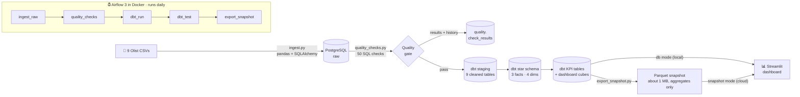
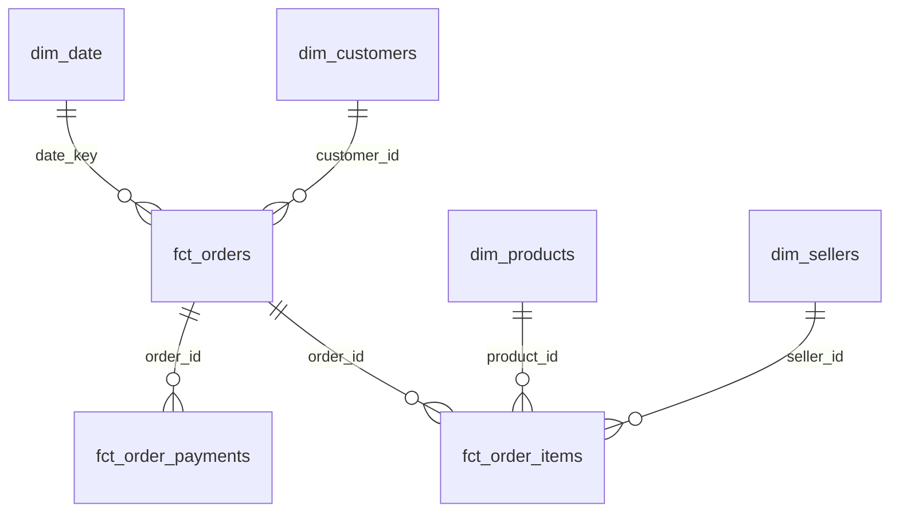
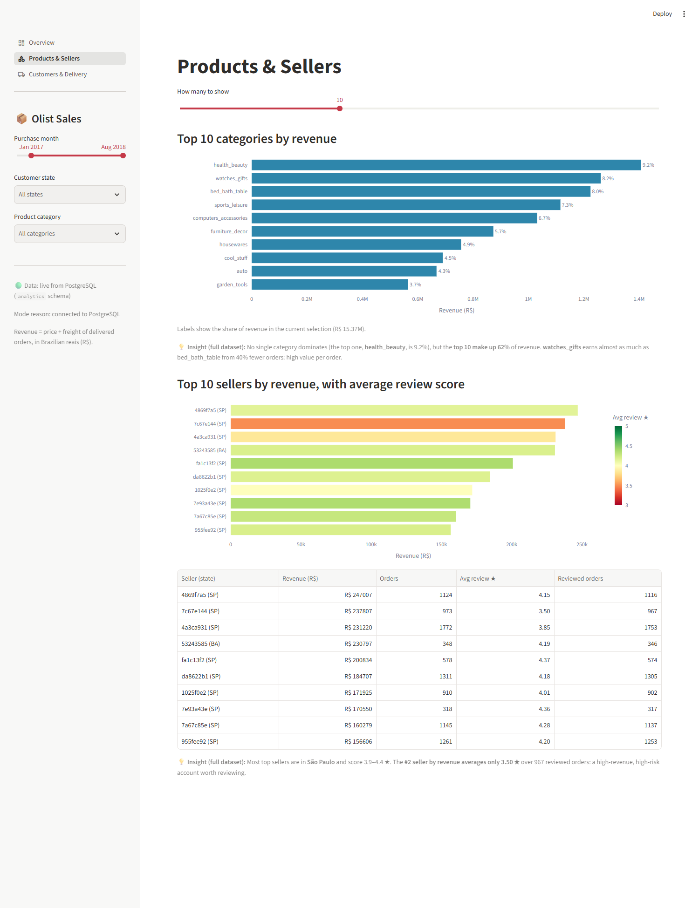
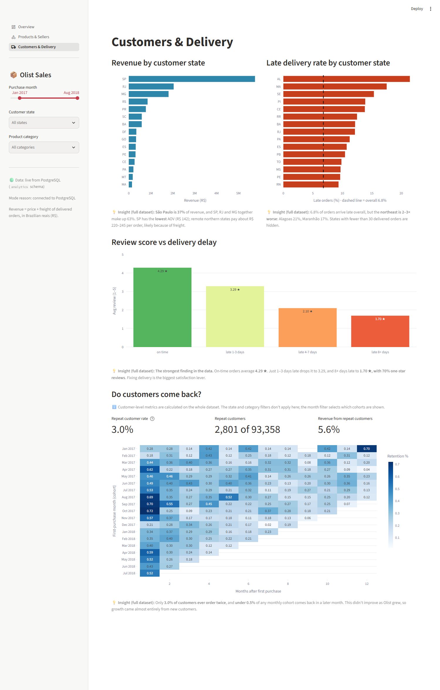

# Olist Sales Analytics Pipeline

**An end-to-end data pipeline that turns 100k raw e-commerce orders into a tested star schema and an interactive KPI dashboard, orchestrated daily by Airflow.**


### 🔗 Live dashboard: [https://yokesh-olist-sales-analytics.streamlit.app](https://yokesh-olist-sales-analytics.streamlit.app)


---

## The problem

[Olist](https://olist.com/) is a Brazilian online marketplace. Its public dataset has about 100,000 orders (2016–2018) split across 9 CSV files: orders, items, payments, reviews, customers, sellers, products, geolocation and category names. Questions like these can't be answered from the raw files without a lot of manual work:

- Is revenue still growing, and which categories, sellers and states drive it?
- Are deliveries on time, and **does late delivery hurt customer reviews?**
- Do customers come back?

This project builds a reproducible pipeline that answers them every day, from raw CSV to dashboard.

## Key business insights

| | Finding |
|---|---|
| 📈 **Growth stalled** | Revenue grew about 8× in 2017, peaked in **Nov 2017 (Black Friday, +54%)**, then **flattened at about R$ 1.0–1.13M per month** through 2018. |
| 🚚 **Late delivery destroys satisfaction** | On-time orders average **4.29 ★**. Orders 8+ days late average **1.70 ★, and 70% of them get one star**. Even 1–3 days late costs a full star. |
| 🗺️ **Delivery problems are regional** | 6.8% of orders arrive late overall, but **Alagoas (21%) and Maranhão (17%)** in the northeast are 2–3× worse. |
| 🔁 **Customers rarely return** | Only **3.0% of customers ever order twice**, and under 0.5% of any monthly cohort comes back later. Growth came from new customers only. |
| 🛍️ **No single category dominates** | The top category (health & beauty) is 9.2% of revenue; the top 10 make up 62%. São Paulo alone is **37%** of revenue. |
| 💳 **Installments matter** | Credit cards are 78% of payment value, with **3.5 installments** on average. |

**Recommendation:** fix delivery reliability in the northeast first (the biggest lever on reviews), then invest in retention, which is almost non-existent.

KPI definitions and formulas: [docs/kpi_definitions.md](docs/kpi_definitions.md).

## Architecture



| Step | What happens |
|---|---|
| **Ingest** | Every CSV is loaded into a `raw` schema as text, so values like zip codes keep their leading zeros. Full refresh: safe to re-run. Logged per table. |
| **Quality gate** | 50 SQL checks on keys, foreign keys, nulls, value ranges and date logic. Broken keys **FAIL** and stop the pipeline; smaller issues **WARN**. Every run's results are kept. |
| **Staging (dbt)** | One model per raw table: clear names, correct types, trimmed text, duplicates removed, categories in English. |
| **Star schema (dbt)** | 3 fact tables (order items, orders, payments) and 4 dimensions (customers, products, sellers, date). |
| **KPIs (dbt)** | Pre-computed KPI tables, plus additive "cube" tables the dashboard can filter by month × state × category. |
| **Dashboard** | Streamlit + Plotly, 3 pages, filters, cached loading. Reads PostgreSQL locally or the Parquet snapshot in the cloud. |
| **Orchestration** | Airflow runs all 5 steps daily in Docker. A failed step stops the steps after it; each task retries twice. |

### Star schema



| Table | Grain (one row per…) | Rows |
|---|---|---:|
| `fct_order_items` | item in an order | 112,650 |
| `fct_orders` | order | 99,441 |
| `fct_order_payments` | payment | 103,886 |
| `dim_customers` / `dim_products` / `dim_sellers` / `dim_date` | customer / product / seller / day | 99,441 / 32,951 / 3,095 / 800 |

## Dashboard

Three pages with sidebar filters for **purchase month, customer state and product category**:

| Overview | Products & Sellers | Customers & Delivery |
|---|---|---|
|  |  |  |
| KPI cards, monthly revenue, MoM growth | Top categories with share, top sellers with review score | Revenue and late rate by state, review vs delay, repeat rate, cohort heatmap |

## Data quality and testing

| Layer | What is tested | Result |
|---|---|---|
| Raw data (`quality_checks.py`) | 50 checks: row counts, primary keys, foreign keys (orphan rows), nulls, parseable dates and numbers, value ranges, date logic | 46 PASS · 4 WARN · 0 FAIL |
| Models (dbt) | `unique` / `not_null` on every key, `relationships` from facts to dims, `accepted_values` | 104 tests pass |
| Reconciliation (dbt singular tests) | Revenue and order totals match across facts, KPI tables and dashboard cubes; shares add up to 100%; cohort rules hold | Pass |
| Dashboard | All pages in both data modes; filtered numbers compared with SQL on the fact tables | Identical |

**The 4 warnings were real data issues,** and dbt handles each one:

- One `review_id` is reused across several orders. Reviews are keyed on review + order, and each order keeps its latest review.
- 610 products have no category. They're labelled `unknown`, so their revenue still counts.
- 2 categories have no English translation. They're translated by hand.
- 8 orders are marked "delivered" with no delivery date. They're left out of delivery KPIs.

## Tech stack

| | |
|---|---|
| Language | Python 3.12, SQL (PostgreSQL dialect) |
| Storage | PostgreSQL 18 (`raw` → `staging` → `analytics` schemas) |
| Ingestion | pandas, SQLAlchemy |
| Transformation & tests | dbt-core 1.12, dbt-postgres |
| Orchestration | Apache Airflow 3.3 (Docker Compose, LocalExecutor) |
| Dashboard | Streamlit, Plotly, Parquet (pyarrow) |
| Tooling | Docker Desktop, Git, VS Code |

## Project structure

```
├── src/
│   ├── db.py                 # one place that builds the DB connection (reads .env)
│   ├── ingest.py             # CSVs -> raw schema
│   ├── quality_checks.py     # 50 data quality checks
│   ├── run_dbt.py            # loads .env, then runs any dbt command
│   └── export_snapshot.py    # KPI tables -> dashboard/data/*.parquet
├── dbt/                      # staging -> marts (facts, dims, KPI tables) + tests
├── airflow/                  # Dockerfile, docker-compose.yaml, dags/olist_pipeline.py
├── sql/kpis/                 # 10 standalone KPI queries (CTEs, window functions, cohorts)
├── dashboard/                # Streamlit app, pages, Parquet snapshot
├── docs/                     # technical design, KPI definitions, screenshots
├── data/raw/                 # Olist CSVs (not committed; download from Kaggle)
├── requirements.txt          # laptop: pipeline + dashboard
├── requirements-pipeline.txt # pipeline only (also used by the Airflow image)
└── .env.example              # credential template (.env itself is never committed)
```

## How to run locally

### Option A: dashboard only (no database, about 2 minutes)

The repo includes a small Parquet snapshot of the KPI tables:

```bash
git clone https://github.com/Yokesh0404/sales-analytics-pipeline.git
cd sales-analytics-pipeline
python -m venv .venv
.venv\Scripts\activate                   # Windows  (macOS/Linux: source .venv/bin/activate)
pip install -r dashboard/requirements.txt
streamlit run dashboard/app.py           # opens http://localhost:8501
```

### Option B: full pipeline

**You need:** Python 3.12, PostgreSQL, Docker Desktop (only for Airflow).

1. **Get the data:** download the [Olist dataset from Kaggle](https://www.kaggle.com/datasets/olistbr/brazilian-ecommerce) and unzip the 9 CSVs into `data/raw/`.
2. **Create the database:** in pgAdmin (or `psql`), create an empty database named `olist`.
3. **Install:**
   ```bash
   python -m venv .venv
   .venv\Scripts\activate
   pip install -r requirements.txt
   copy .env.example .env                 # macOS/Linux: cp .env.example .env
   ```
   Edit `.env`: set your PostgreSQL password, and generate the Airflow secrets (the commands are in the file).
4. **Run each step:**
   ```bash
   python src/check_connection.py         # 1. test the database connection
   python src/ingest.py                   # 2. CSVs -> raw schema
   python src/quality_checks.py           # 3. 50 data quality checks
   python src/run_dbt.py run              # 4. build staging, star schema, KPI tables
   python src/run_dbt.py test             # 5. 104 dbt tests
   python src/export_snapshot.py          # 6. refresh the dashboard snapshot
   streamlit run dashboard/app.py         # 7. open the dashboard
   ```
5. **Or let Airflow run it daily:**
   ```bash
   cd airflow
   docker compose --env-file ../.env up -d --build
   ```
   Open http://localhost:8080, log in with the admin user from `.env`, and switch on the `olist_pipeline` DAG.

### Deploy the dashboard to Streamlit Community Cloud

At [share.streamlit.io](https://share.streamlit.io), create an app from this repo:
- **Branch:** `main`
- **Main file:** `dashboard/app.py`
- **Python:** 3.12
- **Secrets:** `DASHBOARD_DATA_MODE = "snapshot"`

It installs `dashboard/requirements.txt` and reads the Parquet snapshot; no database is needed.

## What I learned

- **Test the data, not just the code.** The quality checks found real problems: reused review IDs, products with no category, and "delivered" orders without a date. Without the checks, these would silently skew the KPIs.
- **Decide the grain first.** Counting orders from an item-level table inflates them. That's why there are separate order-level and item-level fact tables, and why the dashboard gives each order one "main category".
- **Idempotent steps make retries safe.** Full-refresh loads and dbt rebuilds mean Airflow can retry a failed task without duplicating data.
- **A clean install catches what your laptop hides.** Building the Docker image found a dependency pin that was out of date. My own environment had quietly upgraded, so it never showed the problem.
- **Real environments have limits.** On a 6 GB laptop, Docker Desktop crashed while unpacking the Airflow image. I learned to read the actual error (a read-only file system, not my code), free memory, and slim the setup down to LocalExecutor with no Celery or Redis.
- **Small details break things.** An unsaved `.env` meant PostgreSQL rejected the password. Health checks with a 10-second timeout marked healthy services as "unhealthy". In Airflow 3, `@daily` runs at the *start* of the day.

## Future improvements

- **Incremental loads** instead of full refresh, using dbt incremental models, if the data grew beyond a static dataset.
- **Push the snapshot automatically** after the daily run, or point the cloud dashboard at a hosted Postgres (Neon or Supabase) so it's always live.
- **Run Airflow in the cloud** so the DAG runs daily even when the laptop is off, with failure alerts (email or Slack).
- **CI with GitHub Actions:** run `dbt build` and the dashboard tests on every push.
- **Deeper analysis:** model the revenue impact of late deliveries by state, and investigate why retention is so low.

## Data source and license

- **Code:** [MIT License](LICENSE).
- **Data:** [Brazilian E-Commerce Public Dataset by Olist](https://www.kaggle.com/datasets/olistbr/brazilian-ecommerce) on Kaggle, licensed **CC BY-NC-SA 4.0**. The raw data isn't in this repo; only small aggregated KPI tables derived from it are included, for the dashboard. This is a non-commercial portfolio project.

---

More detail: [technical design](docs/technical_design.md) · [KPI definitions](docs/kpi_definitions.md)

Built by **Yokesh** · [GitHub @Yokesh0404](https://github.com/Yokesh0404)
