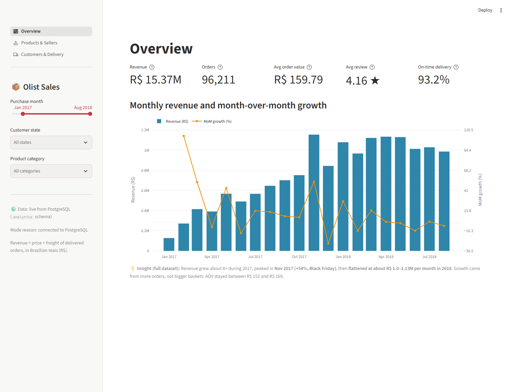
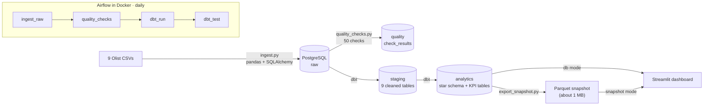
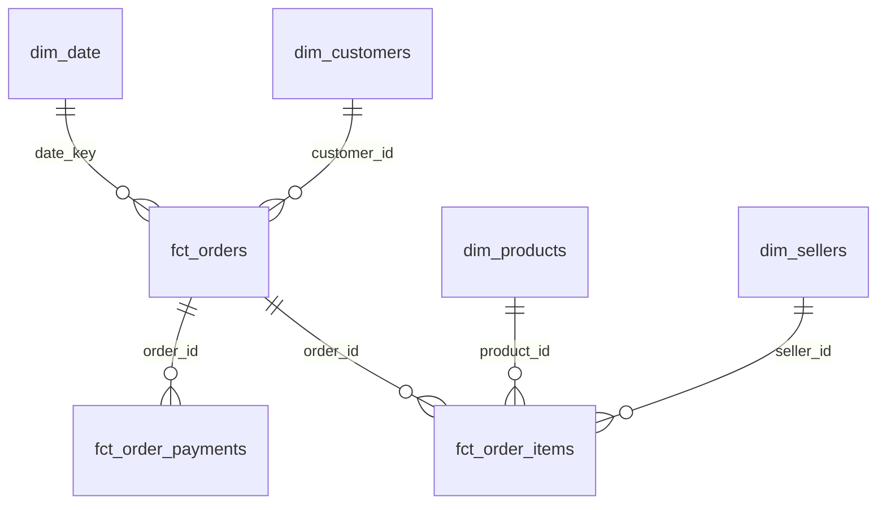

# Olist Sales Analytics Pipeline

An end-to-end data pipeline on 100k real e-commerce orders: **Python ingestion → data quality checks → dbt star schema → Airflow orchestration → Streamlit dashboard.**

**Live dashboard:** _link added after deployment_



---

## The problem

[Olist](https://olist.com/) is a Brazilian online marketplace. Its public dataset has about 100,000 orders (2016–2018) split across 9 CSV files. Questions like these can't be answered from raw files without a lot of manual work:

- Is revenue still growing, and which categories, sellers and states drive it?
- Are deliveries on time, and **does late delivery hurt customer reviews?**
- Do customers come back?

This project builds a reproducible pipeline that turns the raw files into tested, documented tables and an interactive dashboard that answers them.

## Key insights

| | Finding |
|---|---|
| 📈 **Growth stalled** | Revenue grew about 8× in 2017, peaked in **Nov 2017 (Black Friday, +54%)**, then **flattened at about R$ 1.0–1.13M per month** through 2018. |
| 🚚 **Late delivery destroys satisfaction** | On-time orders average **4.29 ★**. Orders 8+ days late average **1.70 ★, and 70% of them get one star**. Even 1–3 days late costs a full star. |
| 🗺️ **Delivery problems are regional** | 6.8% of orders arrive late overall, but **Alagoas (21%) and Maranhão (17%)** in the northeast are 2–3× worse. |
| 🔁 **Customers rarely return** | Only **3.0% of customers ever order twice**, and under 0.5% of any monthly cohort comes back later. Growth came from new customers only. |
| 🛍️ **No single category dominates** | The top category (health & beauty) is 9.2% of revenue; the top 10 make up 62%. São Paulo alone is **37%** of revenue. |
| 💳 **Installments matter** | Credit cards are 78% of payment value, with **3.5 installments** on average. |

**Recommendation:** fix delivery reliability in the northeast first (the biggest lever on reviews), then invest in retention, which is almost non-existent.

All KPI definitions and formulas are in [docs/kpi_definitions.md](docs/kpi_definitions.md).

## Architecture



| Layer | What happens |
|---|---|
| **Ingestion** | Every CSV is loaded into a `raw` schema as text (so zip codes keep their leading zeros). Full refresh, safe to re-run, logged. |
| **Data quality** | 50 SQL checks: keys, foreign keys, nulls, value ranges, date logic. Broken keys **FAIL** and stop the pipeline; smaller issues **WARN**. Results are stored with history. |
| **Transformation (dbt)** | Staging cleans each table (types, names, duplicates, English categories). The marts form a **star schema**: 3 facts and 4 dimensions, plus KPI tables. **104 tests.** |
| **Orchestration** | Airflow 3 in Docker runs the four steps daily. A failed step stops the steps after it; tasks retry twice. |
| **Dashboard** | Streamlit + Plotly, 3 pages, filters for month / state / category. Reads PostgreSQL locally, or a Parquet snapshot in the cloud. |

### Star schema



| Table | Grain (one row per…) | Rows |
|---|---|---:|
| `fct_order_items` | item in an order | 112,650 |
| `fct_orders` | order | 99,441 |
| `fct_order_payments` | payment | 103,886 |
| `dim_customers` / `dim_products` / `dim_sellers` / `dim_date` | customer / product / seller / day | 99,441 / 32,951 / 3,095 / 800 |

## Tech stack

| | |
|---|---|
| Language | Python 3.12, SQL |
| Database | PostgreSQL 18 |
| Ingestion | pandas, SQLAlchemy |
| Transformation & testing | dbt-core 1.12 + dbt-postgres |
| Orchestration | Apache Airflow 3.3 (Docker Compose, LocalExecutor) |
| Dashboard | Streamlit, Plotly, Parquet (pyarrow) |
| Tooling | Docker Desktop, Git, VS Code |

## Dashboard

| Products & Sellers | Customers & Delivery |
|---|---|
|  |  |

## How to run

### Option A: dashboard only (2 minutes, no database)

The repo includes a small Parquet snapshot of the KPI tables, so the dashboard runs without PostgreSQL:

```bash
git clone https://github.com/Yokesh0404/sales-analytics-pipeline.git
cd sales-analytics-pipeline
python -m venv .venv
.venv\Scripts\activate            # Windows  (macOS/Linux: source .venv/bin/activate)
pip install -r dashboard/requirements.txt
streamlit run dashboard/app.py    # opens http://localhost:8501
```

### Option B: full pipeline

**Prerequisites:** Python 3.12, PostgreSQL, Docker Desktop (for Airflow).

1. **Get the data:** download the [Olist dataset from Kaggle](https://www.kaggle.com/datasets/olistbr/brazilian-ecommerce) and unzip the 9 CSVs into `data/raw/`.
2. **Set up:**
   ```bash
   python -m venv .venv && .venv\Scripts\activate
   pip install -r requirements.txt
   copy .env.example .env           # then edit: DB password, Airflow secrets
   ```
   Create an empty database called `olist` in PostgreSQL.
3. **Run the pipeline step by step:**
   ```bash
   python src/check_connection.py   # test the database connection
   python src/ingest.py             # CSVs -> raw schema
   python src/quality_checks.py     # 50 data quality checks
   python src/run_dbt.py run        # build staging + star schema + KPI tables
   python src/run_dbt.py test       # 104 dbt tests
   python src/export_snapshot.py    # refresh the dashboard snapshot
   streamlit run dashboard/app.py
   ```
4. **Or let Airflow run it daily:**
   ```bash
   cd airflow
   docker compose --env-file ../.env up -d --build
   ```
   Open http://localhost:8080 (login from `.env`) and switch on the `olist_pipeline` DAG.

## Project structure

```
├── src/                 # ingest, quality checks, dbt runner, snapshot export, DB helper
├── dbt/                 # dbt project: staging -> marts (facts, dims, KPI tables) + tests
├── airflow/             # Dockerfile, docker-compose.yaml, dags/olist_pipeline.py
├── sql/kpis/            # 10 standalone, commented KPI queries (CTEs, window functions, cohorts)
├── dashboard/           # Streamlit app, pages, Parquet snapshot
├── docs/                # technical design, KPI definitions, screenshots
├── data/raw/            # Olist CSVs (not committed; download from Kaggle)
├── requirements.txt     # full pipeline dependencies (pinned)
└── .env.example         # template for credentials (.env is never committed)
```

## Engineering decisions worth noting

- **Idempotent steps:** every step can be re-run safely. That's what makes Airflow retries safe.
- **Raw layer is untouched text:** cleaning happens in dbt, so any mistake can be fixed and rebuilt without re-downloading.
- **Data quality found real issues,** and dbt fixes them: review IDs reused across orders, 610 products with no category, untranslated categories, and orders marked delivered with no delivery date.
- **Two order grains:** an order-level and an item-level fact table, so order counts are never inflated by multi-item orders.
- **Reconciliation tests:** revenue and order totals are checked to match across raw, facts, KPI tables and dashboard cubes.
- **No secrets in code:** every credential comes from `.env` or environment variables, including dbt's `profiles.yml` and the Docker Compose file.
- **The cloud dashboard contains no personal data:** the snapshot export refuses any table with customer- or order-level columns.

More detail is in [docs/technical_design.md](docs/technical_design.md).

## Data source and license

Data: [Brazilian E-Commerce Public Dataset by Olist](https://www.kaggle.com/datasets/olistbr/brazilian-ecommerce) (Kaggle), licensed **CC BY-NC-SA 4.0**. The raw data isn't included in this repo; only small aggregated KPI tables are, for the dashboard. This is a non-commercial portfolio project.

---

Built by **Yokesh** · [GitHub](https://github.com/Yokesh0404)
