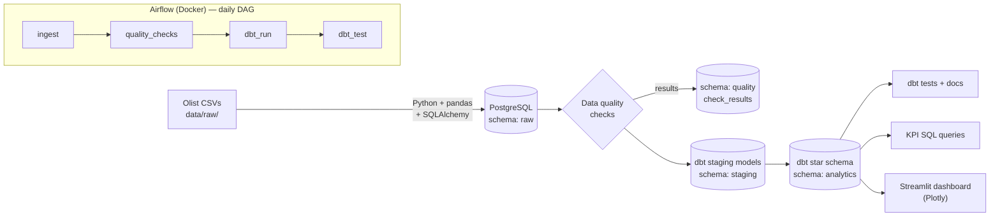
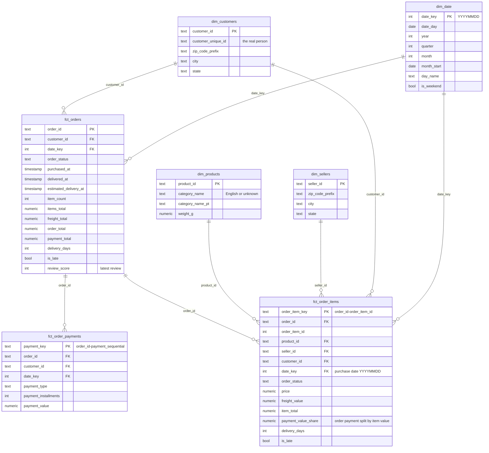
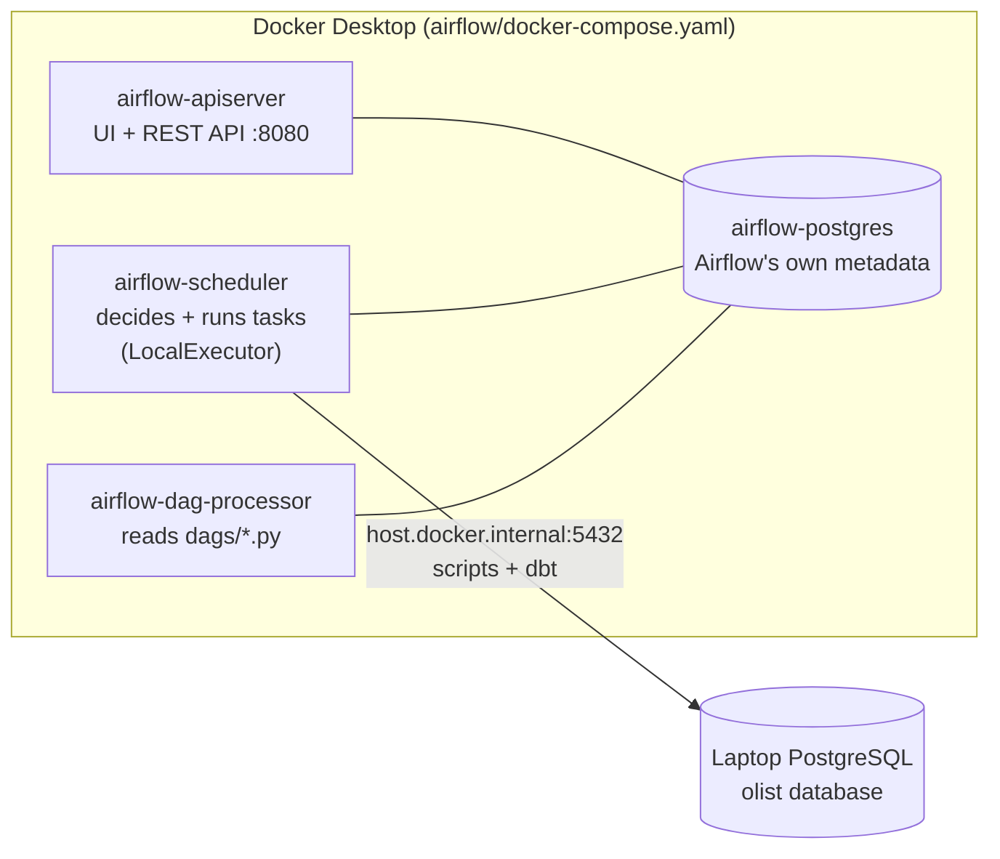
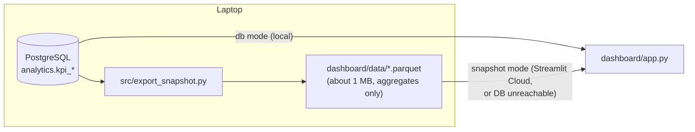

# Technical Design Document: Olist Sales Analytics Pipeline

| | |
|---|---|
| **Status** | In progress (Stages 1–7 of 8 complete) |
| **Last updated** | 2026-11-16 |
| **Author** | Yokesh |

---

## 1. Overview

### 1.1 Problem statement

Olist is a Brazilian e-commerce marketplace. Its public dataset (about 100k orders, 2016–2018) is split across 9 CSV files: orders, items, payments, reviews, customers, sellers, products, geolocation and a category-name translation table. In this form a business user can't easily answer questions like:

- How is revenue trending month over month?
- Which product categories and sellers drive the most sales?
- Where are deliveries late, and does lateness hurt review scores?
- How many customers come back to buy again?

### 1.2 Goal

Build a reproducible, end-to-end analytics pipeline that:

1. **Ingests** the raw CSVs into PostgreSQL.
2. **Validates** data quality and reports issues.
3. **Transforms** the data into a tested, documented star schema with dbt.
4. **Orchestrates** the whole flow daily with Airflow.
5. **Serves** KPIs through SQL queries and an interactive Streamlit dashboard.

### 1.3 Non-goals

- Real-time or streaming ingestion. The source is a static dataset, so batch is enough.
- Machine learning or forecasting.
- Production-grade security, high availability or multi-user access control.

### 1.4 Constraints

- Runs on a single Windows 11 laptop: Python 3.12, PostgreSQL, Docker Desktop.
- The repository stays **local only**: commits are made, but nothing is pushed to GitHub.
- No credentials in code. All secrets come from environment variables loaded from `.env`.
- The code must be simple and commented well enough to explain line by line in an interview.

---

## 2. Target architecture



### 2.1 Data layers

| Layer | Location | Owner | Purpose |
|---|---|---|---|
| Raw files | `data/raw/*.csv` | Kaggle download | Source of truth, never modified |
| `raw` schema | PostgreSQL | `src/ingest.py` | 1:1 copy of each CSV, all text, no cleaning |
| `quality` schema | PostgreSQL | `src/quality_checks.py` | History of data quality check results |
| `staging` schema | PostgreSQL | dbt | Renamed columns, correct data types, trimmed text, duplicates removed; one model per raw table |
| `analytics` schema | PostgreSQL | dbt | Star schema (facts + dimensions) for analytics and the dashboard |

Keeping raw data untouched means a mistake in a transformation can always be fixed and rebuilt without downloading anything again.

### 2.2 Tech stack

| Concern | Tool | Why this choice |
|---|---|---|
| Language | Python 3.12 | Standard for data work; pandas ecosystem |
| Database | PostgreSQL 18 | Free, widely used, supported by dbt and Airflow |
| Loading | pandas + SQLAlchemy | `DataFrame.to_sql` makes CSV → table a few lines of code |
| Transformation | dbt-core 1.12 + dbt-postgres 1.11 | SQL-based models with built-in testing, lineage and docs |
| Orchestration | Apache Airflow 3.3.2 (Docker Compose, LocalExecutor) | Industry-standard scheduler; Docker avoids Windows install issues |
| Dashboard | Streamlit 1.67 + Plotly 7.1 (+ pyarrow for Parquet) | Pure-Python web app with interactive charts |
| Config | python-dotenv + `.env` | Keeps credentials out of source control |
| Version control | Git (local) | History of every stage |

---

## 3. What is built so far (Stages 1–7)

### 3.1 Repository layout

```
sales_analytics_pipeline/
├── .env.example          # template for DB + Airflow credentials (committed)
├── .env                  # real credentials (git-ignored)
├── .gitignore
├── .dockerignore         # only requirements.txt goes into the Docker build
├── README.md
├── requirements.txt      # pinned Python dependencies (laptop AND Airflow image)
├── airflow/
│   ├── Dockerfile        # official Airflow image + separate venv for the pipeline
│   ├── docker-compose.yaml  # metadata Postgres, init, api-server, scheduler, dag-processor
│   ├── dags/
│   │   └── olist_pipeline.py  # the daily DAG
│   └── logs/             # Airflow task logs (git-ignored)
├── dashboard/
│   ├── app.py            # entry point: data mode, sidebar filters, navigation
│   ├── loaders.py        # mode detection, cached loading, filters, formatting
│   ├── views/            # overview.py, products_sellers.py, customers_delivery.py
│   ├── data/             # snapshot: 5 Parquet files + manifest.json (about 1 MB, committed)
│   └── requirements.txt  # slim requirements for Streamlit Cloud
├── data/
│   └── raw/              # Olist CSVs go here (git-ignored, .gitkeep tracked)
├── dbt/                  # dbt project "olist_dbt"
│   ├── dbt_project.yml   # project settings: schemas + materializations
│   ├── profiles.yml      # connection, every value read with env_var()
│   ├── macros/
│   │   └── generate_schema_name.sql  # use schema names exactly as written
│   ├── models/
│   │   ├── staging/      # _sources.yml, _staging.yml, 9 x stg_*.sql
│   │   └── marts/        # _marts.yml, 3 x fct_*.sql, 4 x dim_*.sql
│   │       └── kpi/      # _kpi.yml, 8 x kpi_*.sql (pre-computed KPI tables)
│   ├── tests/            # 3 singular tests (KPI reconciliation, shares, cohort rules)
│   ├── target/           # compiled SQL + docs site (git-ignored)
│   └── logs/             # dbt logs (git-ignored)
├── docs/
│   ├── technical_design.md
│   ├── kpi_definitions.md   # every KPI: definition, formula, business question
│   └── images/           # dashboard screenshots for the README
├── logs/                 # ingestion.log, quality.log (git-ignored)
├── sql/
│   └── kpis/             # 01_ … 10_*.sql: one standalone, commented query per KPI
└── src/
    ├── db.py             # get_engine(): single place that builds the DB connection
    ├── check_connection.py  # smoke test: connects and prints the Postgres version
    ├── ingest.py         # loads every CSV into the raw schema
    ├── quality_checks.py # data quality checks on the raw schema
    ├── run_dbt.py        # loads .env, then runs any dbt command
    └── export_snapshot.py  # exports the dashboard's KPI tables to dashboard/data/*.parquet
```

### 3.2 Components

**`src/db.py`: connection helper**
- Calls `load_dotenv()` to read `.env` into environment variables. Values that are already set, for example by Docker later, are not overwritten.
- Builds the connection with `sqlalchemy.engine.URL.create(...)` rather than gluing a string together, so special characters in passwords are escaped safely.
- Required variables (`POSTGRES_USER`, `POSTGRES_PASSWORD`, `POSTGRES_DB`) are read with `os.environ[...]`, so a missing value fails immediately. Host and port have defaults (`localhost`, `5432`).

**`src/check_connection.py`: smoke test**
- Runs `SELECT version()`, prints the result, and catches `OperationalError` with a short hint about what to check.

**Dependency management**
- A project-local virtual environment in `.venv/`.
- `requirements.txt` pins exact versions: pandas 2.2.3, SQLAlchemy 2.0.36, psycopg2-binary 2.9.10, python-dotenv 1.2.4, dbt-core 1.12.7, dbt-postgres 1.11.0, dbt-adapters 1.24.5.
- The same file is installed into the Airflow image, so the laptop and Docker run identical versions. Building the image caught a stale pin: python-dotenv was still pinned at 1.0.1 after the Stage 4 dbt upgrade, which needs 1.2 or newer. It's fixed now.

**Secrets handling**
- `.env` is git-ignored (checked with `git check-ignore`). Only `.env.example` with placeholder values is committed.
- dbt's `profiles.yml` reads every connection value with `env_var()`, so it contains no secrets and is safe to commit.

**`src/ingest.py`: ingestion (Stage 2)**
- Implements the design in section 4.1. Each CSV is read with `dtype=str`, so every raw column is `TEXT` and values such as zip codes keep their leading zeros.
- Each table is written inside its own transaction (`engine.begin()`). If a load fails partway, the previous version of that table is kept.
- Paths are built from the script's own location, so it works from any working directory.
- A full run takes about 80 seconds. Most of that is `geolocation`, at 1M rows and about 44 seconds.

**Loaded tables (verified 2026-11-16).** Row counts in PostgreSQL match an independent count of each CSV, done with Python's `csv` module:

| Table | Rows |
|---|---:|
| `raw.customers` | 99,441 |
| `raw.geolocation` | 1,000,163 |
| `raw.order_items` | 112,650 |
| `raw.order_payments` | 103,886 |
| `raw.order_reviews` | 99,224 |
| `raw.orders` | 99,441 |
| `raw.products` | 32,951 |
| `raw.sellers` | 3,095 |
| `raw.product_category_name_translation` | 71 |

**`src/quality_checks.py`: data quality (Stage 3)**
- 50 checks. Each one is a SQL query that counts the rows breaking one rule. 0 rows means PASS; otherwise the check gets its severity, **FAIL** (broken keys) or **WARN** (smaller issues).
- Check types: row count > 0, primary key not-null and unique, foreign keys resolve (orphan count), nulls in important columns, text that converts cleanly to timestamp or numeric (`pg_input_is_valid`, PostgreSQL 16+), value ranges (prices ≥ 0, review score 1–5, known order statuses), and date logic.
- If a check's query errors (for example a missing table), that check is marked FAIL rather than crashing the whole run.
- Results are appended to `quality.check_results` with a `run_at` timestamp, so the history of every run is kept. They're also logged to `logs/quality.log` and printed as a summary table.
- Exit code 1 if any check FAILs, so Airflow will stop the pipeline. Tested with an injected failing check.

**Quality results (run 2026-11-16): 46 PASS, 4 WARN, 0 FAIL**

| Check | Table | Status | Rows | What it means | Handling (done in Stage 4) |
|---|---|---|---:|---|---|
| `unique(review_id)` | order_reviews | WARN | 814 extra rows (789 review IDs) | Each duplicated `review_id` is attached to *different* orders: one review covering several orders. 547 orders also have more than one review. | ✅ `stg_order_reviews` uses key `review_id + order_id`. `fct_orders` keeps only the latest review per order, leaving 0 duplicate orders. |
| `not_null(product_category_name)` | products | WARN | 610 (1.85%) | These products also have no name or description lengths: missing catalog data. They appear in 1,603 order items. | ✅ Labeled `unknown` in `stg_products`, so their revenue stays in totals. |
| `fk(product_category_name -> translation)` | products | WARN | 13 | Two categories have no English translation: `pc_gamer` (3) and `portateis_cozinha_e_preparadores_de_alimentos` (10). | ✅ Translated by hand in `stg_products` (`pc_gamer`, `portable_kitchen_and_food_preparers`). |
| `delivered orders have delivery date` | orders | WARN | 8 | Status is `delivered` but the customer delivery date is missing; 7 of the 8 do have a carrier date. | ✅ Documented only. `delivery_days` and `is_late` are NULL for these, so they drop out of delivery KPIs automatically but stay in revenue. |

**`src/run_dbt.py` + `dbt/`: transformation (Stage 4)**
- `run_dbt.py` loads `.env`, then runs dbt in the same Python process (`dbtRunner`) with `--project-dir dbt --profiles-dir dbt`. dbt itself doesn't read `.env` files. In Airflow, Docker will supply the same environment variables directly.
- `generate_schema_name` macro: by default dbt would build into `analytics_staging`. The override makes it use `staging` and `analytics` exactly.
- **Staging and marts are both materialized as tables.** This resolves risk #5 (section 6): PostgreSQL won't drop a table that a *view* depends on, so staging views would make `ingest.py` fail on re-run. I chose tables over making ingestion `DROP ... CASCADE`, because CASCADE would silently delete the dbt models and leave the dashboard empty until the next `dbt run`. The cost of tables is extra disk space (small here) and the data being as fresh as the last `dbt run`, which is fine for a daily batch. Verified: `ingest.py` re-ran successfully with all dbt tables in place.

#### Staging vs marts (interview version)

- **Staging = clean copies.** One model per raw table. It only *tidies*: clear column names, correct types (text → timestamp/numeric), trimmed text, exact duplicates removed. No business logic and no combining of tables (except the category translation lookup). If a raw column is renamed upstream, only one staging model changes.
- **Marts = business-ready tables.** Built *from staging*, shaped for questions people ask: revenue by month, by category, late deliveries. This is what the dashboard and the KPI queries read.

#### Fact vs dimension, and grain (interview version)

- **Fact table = events you measure.** Each row is something that happened (an order, an item sold) with numbers you can add up: price, freight, payment. Facts are long and narrow.
- **Dimension table = the context you filter and group by.** *Who* (customer, seller), *what* (product), *when* (date). Dimensions are short and wide (descriptive columns).
- **Star schema** = one fact in the middle, dimensions around it, joined by keys. It's simple to query: one join per question ("revenue by state" = fact join dim_customers, group by state).
- **Grain = what one row means.** It's the first thing to decide, because it determines what you can sum safely.
  - `fct_order_items`: **one row per item in an order.** This is the only level that links to one product and one seller, so it's used for category and seller revenue.
  - `fct_orders`: **one row per order.** Used for order counts, average order value, delivery and reviews. Without it, an order with 3 items would be counted 3 times.

#### Star schema (built)



Design notes:
- **`fct_order_payments`** (one row per payment, 103,886 rows) was added in Stage 6. Payment type only existed in staging, and KPIs must read the `analytics` schema only.
- **Two fact tables at two grains**, rather than one. `fct_order_items` gets order-level values (customer, date, delivery) by joining `fct_orders`, so delivery logic is written once.
- **`fct_orders` includes all 99,441 orders**, including 775 with no items (mostly canceled or unavailable). Their money columns are 0, so status counts stay complete.
- **`payment_value_share`:** payments are recorded per order, not per item, so each item gets a share in proportion to its value (`payment_total × item_total / order_total`). Shares match order payments for every order except one 21-item order, which is 6 cents off from rounding.
- **`dim_date`** is generated with `generate_series` over the full date range (800 days). It includes days with no sales, so charts have no gaps. `date_key` is an integer `YYYYMMDD`.
- **Composite keys** (order item, payment, review) are combined into one text key, such as `order_id-order_item_id`, so they can use dbt's built-in `unique` test without an extra package.

**dbt run results (2026-11-16)**
- `dbt run`: 15 models (9 staging + 6 marts), all OK, about 17 seconds.
- `dbt test`: **65 tests, all PASS**. These are `unique`/`not_null` on every primary key, `relationships` from both facts to every dimension (and items → orders), and `accepted_values` for `order_status`, `payment_type` and `review_score`.
- `dbt docs generate`: docs site written to `dbt/target/`. View it with `python src/run_dbt.py docs serve`.

| Mart | Rows |
|---|---:|
| `analytics.fct_order_items` | 112,650 |
| `analytics.fct_orders` | 99,441 |
| `analytics.dim_customers` | 99,441 |
| `analytics.dim_products` | 32,951 |
| `analytics.dim_sellers` | 3,095 |
| `analytics.dim_date` | 800 |

**Reconciliation checks (raw vs marts)**

| Check | Result |
|---|---|
| Item price total: raw = `fct_order_items` = `fct_orders` | ✅ 13,591,643.70 in all three |
| Payment total: raw = `fct_orders` | ✅ 16,008,872.12 in both |
| Sum of `payment_value_share` vs payment total | 15,846,281.23. The 162,591.95 difference is exactly the payments of the 775 orders with no items (no item rows to share them across). |
| Geolocation duplicates removed | 1,000,163 → 738,332 (−261,831, matches Stage 3) |
| Delivered orders / average delivery / late rate | 96,476 orders, 12.5 days on average, 6.8% late |

**`airflow/`: orchestration (Stage 5)**



- **Image:** `airflow/Dockerfile` extends `apache/airflow:3.3.2-python3.12` with a **separate virtual environment** (`/opt/airflow/pipeline-venv`) built from the project's `requirements.txt`. The pipeline's packages (pandas, SQLAlchemy 2, dbt) can never clash with the packages Airflow pins for itself. This resolves risk #3.
- **Services:** a small Postgres for Airflow's *metadata* (run history, users), not the olist data; `airflow-init` (creates the metadata tables and the admin user, then exits); `api-server` (UI and REST API on port 8080); `scheduler` (with LocalExecutor it also runs the tasks); `dag-processor`. Compared with the official compose file, Celery, Redis, workers and the triggerer are left out to save memory on a 5.9 GB laptop. The 4 services use about 1.2 GB together.
- **Mounts:** `src/` and `data/` (read-only), `dbt/` (writable, for `target/` and logs), `logs/`, and `airflow/dags`, `airflow/logs`. Code changes on the laptop are picked up without rebuilding the image.
- **Secrets:** all values come from `.env` through `docker compose --env-file ../.env`. That covers the olist DB credentials, the Airflow admin login, the metadata-DB password, the Fernet key and the JWT secret. `${VAR:?message}` makes Compose stop with a clear error if one is missing. The compose file contains no secrets.
- **Reaching the laptop's PostgreSQL:** the containers set `POSTGRES_HOST=host.docker.internal`, which overrides `localhost` from `.env`, because `load_dotenv()` never overwrites variables that are already set. Tested before building: Docker Desktop forwards the traffic so it arrives from `127.0.0.1`, which the default `pg_hba.conf` already allows. **No `pg_hba.conf` or `listen_addresses` change was needed.** This resolves risk #2.
- **DAG `olist_pipeline`** (`airflow/dags/olist_pipeline.py`): `@daily`, `catchup=False`, `max_active_runs=1`, `retries=2` with a 2-minute delay, and a 30-minute timeout per task. Four `BashOperator` tasks: `ingest_raw >> quality_checks >> dbt_run >> dbt_test`. A non-zero exit code fails the task, and the tasks after it don't run. Each task has `doc_md` describing it in the UI.
- **Airflow 3 scheduling note:** `@daily` runs at the *start* of each day (Airflow 2 ran it at the end). Unpausing the DAG therefore started today's scheduled run straight away, before the manual trigger.

**Airflow runs (2026-11-16): 2 of 2 succeeded, 8 of 8 tasks on the first try**

| Run | ingest_raw | quality_checks | dbt_run | dbt_test | Result |
|---|---|---|---|---|---|
| `scheduled__2026-11-16T00:00` (started when unpaused) | ✅ 234 s | ✅ 21 s | ✅ 96 s | ✅ 34 s | SUCCESS |
| `manual__2026-11-16T09:50` (triggered through the REST API) | ✅ 205 s | ✅ 17 s | ✅ 48 s | ✅ 41 s | SUCCESS |

Task logs from the manual run: *"Ingestion finished successfully: 9 tables loaded"*, *"Summary: 46 PASS, 4 WARN, 0 FAIL"*, dbt run *"PASS=15"*, dbt test *"PASS=65"*. `raw.orders._loaded_at` and `quality.check_results` confirm the container run wrote to the laptop's database. Next scheduled run: 2026-11-17 00:00 UTC (only while Docker Desktop is running).

#### Airflow concepts (interview version)

- **Airflow** is a tool that *runs your data jobs in the right order, on a schedule, and shows you what happened*. It doesn't process data itself; it tells your scripts when to run.
- **DAG (Directed Acyclic Graph):** the workflow, meaning a list of tasks plus the arrows between them. *Directed* means arrows have a direction (ingest → quality). *Acyclic* means no loops, so the pipeline always finishes. Mine is a straight line of 4 tasks.
- **Task:** one step in the DAG. Here each task runs one command (`python src/ingest.py`) through a `BashOperator`. The command's exit code decides success or failure.
- **Scheduler:** the part that checks, every few seconds, *"is anything due to run, and are its upstream tasks done?"* and starts it. With LocalExecutor it also runs the task as a process in the same container.
- **Why Docker:** Airflow doesn't run natively on Windows. Docker runs it on Linux inside a container, so it works the same on any machine. Adding the pipeline's own environment to the image means *"it works on my laptop"* also means *"it works in Airflow"*. The build even caught a dependency pin that was wrong on the laptop.
- **Why retries:** many failures are temporary, such as the database restarting, a network blip, or a locked file. Retrying twice with a 2-minute wait fixes those without anyone waking up. Real bugs still fail after the retries, and the DAG stops so bad data never reaches the dashboard. Retries are safe only because every task is **idempotent**: re-running ingestion or dbt gives the same result.

**`sql/kpis/` + `dbt/models/marts/kpi/`: analytics (Stage 6)**

- **10 standalone SQL files** (`sql/kpis/01_…10_*.sql`), one per KPI, querying only `analytics.*`. They're written for reading and explaining: each starts with the business question and the definition, then builds the answer in named CTE steps. Full definitions are in [kpi_definitions.md](kpi_definitions.md).
- **8 dbt KPI tables** in `analytics` (`kpi_monthly_revenue`, `kpi_category_revenue`, `kpi_seller_performance`, `kpi_state_summary`, `kpi_delivery_performance`, `kpi_payment_mix`, `kpi_repeat_customers`, `kpi_cohort_retention`). They're small and pre-computed, so the dashboard reads them instantly instead of re-aggregating 112k rows on every click. They use `ref()`, so they rebuild automatically in the daily DAG's `dbt_run` task.
- **Same logic in both places:** the SQL files exist so the queries can be read and run on their own. The dbt tables are what the dashboard uses. A cross-check confirmed they return identical numbers (monthly revenue total, top category, SP revenue, repeat rate, card share, cohort rows).
- **Tests: 93 in total** (65 from Stage 4 + 25 on the new fact and KPI tables + 3 *singular* tests). A singular test is a plain SQL file in `dbt/tests/` that returns rows only when something is wrong:
  - `assert_kpi_revenue_matches_facts`: the KPI revenue total equals the fact table's total.
  - `assert_shares_sum_to_100`: category, state and payment shares each total 100%.
  - `assert_cohort_retention_valid`: month 0 = 100%, no duplicate rows, retention between 0 and 100%.
- **Date spine:** `kpi_monthly_revenue` joins every month between the first and last sale, so Nov 2016 (0 delivered orders) appears as 0. Otherwise `LAG()` would compare Dec 2016 with Oct 2016 and call it "month over month".

**Headline results:** R$ 15.42M delivered revenue from 96,478 orders. Revenue was flat at about R$ 1.0–1.13M per month in 2018. Late delivery drops the average review from 4.29 to 1.70 (8+ days late). Only 3.0% of customers ordered twice. See [kpi_definitions.md](kpi_definitions.md) for all results.

#### SQL concepts used (interview version)

- **CTE (`WITH name AS (...)`):** a named, temporary result you can use in the next step, like a variable in Python. It turns one huge query into readable steps: "first orders per customer, then summarise".
- **Window function (`... OVER (...)`):** calculates across a set of rows *without collapsing them* the way `GROUP BY` does. For example, `SUM(revenue) OVER ()` puts the grand total on every row, so each row can compute its % share.
- **`LAG(x) OVER (ORDER BY month)`:** "the value of x on the previous row". It's used for month-over-month growth: `(this month − LAG) / LAG`. It needs a gap-free month list (date spine), otherwise "previous row" isn't "previous month".
- **`RANK() OVER (ORDER BY revenue DESC)`:** numbers rows 1, 2, 3… by revenue, with ties getting the same rank.
- **`FILTER (WHERE …)`:** aggregates only some rows, e.g. `COUNT(*) FILTER (WHERE orders > 1)`. It's a cleaner `CASE WHEN` inside an aggregate.
- **`ROLLUP(state)`:** adds a grand-total row to a `GROUP BY` (state = NULL), giving per-state and overall rates in one query.
- **Cohort analysis:** group customers by *when they started* (first purchase month), then track what % of each group comes back in month 1, 2, 3… It separates "are we keeping customers?" from "are we just getting more new ones?"

**`dashboard/`: Streamlit dashboard (Stage 7)**



- **Pages:**
  - **Overview:** 5 KPI cards (revenue, orders, AOV, average review, on-time %) and monthly revenue with MoM growth.
  - **Products & Sellers:** top-N categories with % share, and top-N sellers coloured by review score, with a table.
  - **Customers & Delivery:** revenue by state, late rate by state, review score vs delay, repeat rate and the cohort retention heatmap.

  Every chart has an R$ unit and a 💡 insight caption from Stage 6.
- **Sidebar filters:** purchase-month range (default Jan 2017 – Aug 2018), customer state, product category. An empty selection means "all".
- **Dashboard cubes (new dbt models):** the Stage 6 KPI tables are each summed along one dimension only, so they can't be filtered by month *and* state *and* category together. Three additive "cube" tables solve this. Every column is a sum or a count, so the app filters rows and adds them up, and averages are rebuilt as `sum / count`.
  - `kpi_sales_cube`: month × state × category, item revenue (11,672 rows).
  - `kpi_order_cube`: month × state × **main category** × delivery status, order counts, revenue, review and delivery sums (15,073 rows).
  - `kpi_seller_cube`: seller × month × state × category (54,842 rows).
- **Main category:** 780 delivered orders (0.8%) contain items from 2 or more categories. `fct_orders.main_category` (the category with the most revenue in the order) gives each order exactly one category, so order counts never double up when categories are filtered. Revenue by category still uses each item's real category.
- **Data modes:** `DASHBOARD_DATA_MODE` = `db` / `snapshot` / `auto` (default), read from an environment variable or `st.secrets`. `auto` tries a `SELECT 1` on PostgreSQL and falls back to the snapshot if that fails. On Streamlit Cloud there's no `.env` and no reachable database, so it falls back automatically.
- **Snapshot export:** `src/export_snapshot.py` writes 5 aggregated tables to Parquet (about 1 MB) plus `manifest.json` (export date, shown in the sidebar). A guard **refuses to export** any table with customer- or order-level columns (`customer_id`, `customer_unique_id`, `order_id`, zip, city, review text). Seller IDs are business identifiers, shortened to 8 characters in the UI.
- **Caching:** `@st.cache_data` on `load_table(name, mode)` (1 hour) and on `resolve_mode()` (10 minutes). Each table is loaded once, and every later click or filter change is pandas filtering in memory.
- **Tests: 104 dbt tests pass**, including the new singular test `assert_dashboard_cubes_reconcile` (every cube adds up to the fact-table revenue and order totals).

**Verification (2026-11-16)**

| Check | Result |
|---|---|
| All 3 pages, **db mode** (`AppTest`, headless) | ✅ 0 exceptions; 1 / 2 / 4 charts render |
| All 3 pages, **snapshot mode** (`DASHBOARD_DATA_MODE=snapshot`) | ✅ 0 exceptions; identical numbers to db mode |
| **Auto fallback** (`streamlit run` with an unreachable DB port) | ✅ Switched to snapshot: *"database not reachable (OperationalError)"* |
| Default view KPI cards | R$ 15.37M · 96,211 orders · AOV R$ 159.79 · 4.16 ★ · 93.2% on time (= Stage 6 totals minus 2016) |
| Filter test: Jan–Mar 2018, RJ, health_beauty | R$ 28.7K · 192 orders · AOV R$ 149.64 · 3.83 ★ · 79.7%. **Identical to SQL run directly on the fact tables** |
| Screenshots | `docs/images/01_overview.png`, `02_products_sellers.png`, `03_customers_delivery.png` (Playwright + Edge) |

Run it: `streamlit run dashboard/app.py` → http://localhost:8501. After each `dbt run`, refresh the snapshot with `python src/export_snapshot.py`.

#### Dashboard concepts (interview version)

- **How Streamlit works:** the whole script runs again from top to bottom every time the user clicks something. That keeps the code simple (no callbacks), but it means anything slow must be cached.
- **Caching (`@st.cache_data`):** Streamlit remembers a function's result for the same inputs. The first visit reads the table from PostgreSQL or Parquet; every later rerun gets it from memory instantly. `ttl=3600` makes it re-read after an hour, so new pipeline runs show up. `mode` is a function argument, so the db and snapshot results are cached separately.
- **Why snapshot mode:** Streamlit Community Cloud runs on the internet and can't reach a database on my laptop. Instead of exposing my database, I export the small, pre-aggregated KPI tables (about 1 MB) to Parquet and deploy them with the app. The same code reads either source; only `load_table` knows the difference. It's also safer: the files contain only aggregates, enforced by the export script.
- **Why "cube" tables:** filters need data split by every filter dimension together. Storing sums and counts (not averages) means any filtered subset can be added up correctly. An average of averages would be wrong.

### 3.3 Current state

| Item | Status |
|---|---|
| Virtual environment created, dependencies installed | ✅ Done |
| Git repository initialized, Stage 1 committed (`910bb5c`) | ✅ Done |
| `olist` database created, `.env` configured | ✅ Done |
| Connection test passes (PostgreSQL 18.7) | ✅ Done |
| Olist CSVs placed in `data/raw/` (9 files) | ✅ Done |
| Ingestion loads all 9 tables; counts match CSVs | ✅ Done |
| Re-run gives identical counts (idempotent) | ✅ Verified |
| A failing file is logged and skipped; run exits with code 1 | ✅ Verified (test with an empty CSV) |
| Quality checks run: 50 checks, 46 PASS / 4 WARN / 0 FAIL | ✅ Done |
| Results saved to `quality.check_results` and `logs/quality.log` | ✅ Verified |
| Any FAIL makes the script exit with code 1 | ✅ Verified (injected test check, removed afterwards) |
| dbt installed, `dbt debug` passes with credentials from `env_var()` | ✅ Done |
| 9 staging models + star schema (2 facts, 4 dimensions) built | ✅ Done |
| 65 dbt tests pass | ✅ Done |
| All 4 Stage 3 warnings handled | ✅ Done (see table above) |
| Marts reconcile with raw totals | ✅ Verified |
| `ingest.py` re-runs with dbt tables present (risk #5) | ✅ Verified |
| dbt docs generated | ✅ Done |
| Airflow 3.3.2 image built (pipeline venv: pandas 2.2.3, SQLAlchemy 2.0.36, dbt 1.12.7) | ✅ Done |
| Containers reach the laptop's PostgreSQL through `host.docker.internal` (no `pg_hba.conf` change) | ✅ Verified |
| All 4 Airflow services healthy; UI/API at http://localhost:8080 with admin login from `.env` | ✅ Verified (REST API login) |
| DAG `olist_pipeline` parsed with no import errors | ✅ Verified |
| DAG runs end to end: 2 runs, 8 of 8 tasks succeeded on the first try | ✅ Verified |
| Airflow retries | ⚠️ Configured (`retries=2`) but not exercised, because no task failed |
| `fct_order_payments` added to the star schema (103,886 rows) | ✅ Done |
| 10 KPI SQL files in `sql/kpis/`, all run successfully | ✅ Done |
| 8 dbt KPI tables built; 24 models, 93 tests pass (incl. 3 singular tests) | ✅ Done |
| SQL files and dbt KPI tables return identical numbers | ✅ Verified (6 cross-checks) |
| `docs/kpi_definitions.md` written | ✅ Done |
| Dashboard cubes (`kpi_sales_cube`, `kpi_order_cube`, `kpi_seller_cube`) + `fct_orders.main_category`; 27 models, 104 tests pass | ✅ Done |
| `src/export_snapshot.py`: 5 aggregated tables → Parquet (about 1 MB), personal-data guard | ✅ Done |
| Dashboard: 3 pages, sidebar filters, R$ units, insight captions, `st.cache_data` | ✅ Done |
| Works in db mode, snapshot mode, and auto-fallback when the DB is unreachable | ✅ Verified |
| Filtered numbers match SQL on the fact tables | ✅ Verified |
| Screenshots in `docs/images/` | ✅ Done |
| Stage 8: README + GitHub push + Streamlit Cloud deployment | ⏳ Next |

---

## 4. Planned design (Stage 8)

> Sections 4.1–4.6 describe the original plan for stages already built. Section 3 has what was actually built. Section 4.7 is still a plan and may change.

### 4.1 Stage 2: Ingestion (`src/ingest.py`) (built)

- Finds every `*.csv` in `data/raw/` and loads each one into the `raw` schema. The table name is the file name with the `olist_` prefix and `_dataset` suffix removed, for example `raw.orders`.
- **Re-runnable (idempotent):** each run fully replaces the table (`if_exists="replace"`), so running it twice gives the same result. For a static dataset of this size (about 120 MB), a full refresh is simpler and safer than incremental loading.
- Creates the `raw` schema if it doesn't exist.
- Adds a `_loaded_at` timestamp column for traceability.
- Writes in chunks to keep memory use low.
- **Logging:** Python's `logging` module writes to both the console and `logs/ingestion.log`: file name, row count and duration per table, plus any errors.

### 4.2 Stage 3: Data quality (`src/quality_checks.py`) (built)

- Checks for nulls in key columns, duplicate primary keys, broken foreign keys, unparseable values, out-of-range values and illogical dates.
- Output: results are stored in the table `quality.check_results` (one row per check per run), logged to `logs/quality.log`, and printed as a summary. This replaces the Markdown report file originally planned, because a table keeps history and can be queried or charted later.
- Exit code: non-zero only on **critical** issues (broken keys), so Airflow can stop the pipeline. Known dataset quirks are reported as warnings.

### 4.3 Stage 4: Transformation (dbt) (built)

The built design differs from the original plan in two ways:
- **Two facts instead of one:** the plan had a single item-level `fact_orders`. The build adds an order-level `fct_orders`, so order counts, delivery metrics and review scores don't need `COUNT(DISTINCT order_id)` workarounds.
- **The schema is named `analytics`**, not `marts`.

### 4.4 Stage 5: Orchestration (Airflow in Docker) (built)

Built as planned (see section 3.2). The differences from this plan: retries are 2 (not 1), LocalExecutor without a triggerer, and the pipeline runs in its own venv inside the image.

- `docker-compose.yml` based on the official Airflow image, with its own small Postgres container for Airflow's metadata.
- Pipeline code and the dbt project are mounted into the containers.
- Airflow connects to the **laptop's** PostgreSQL through `host.docker.internal`. Credentials are passed as environment variables from `.env`, which is why `db.py` and `profiles.yml` read environment variables.
- DAG `olist_daily_pipeline`, scheduled `@daily`, `catchup=False`:

```
ingest  →  quality_checks  →  dbt_run  →  dbt_test
```

- Each task is a `BashOperator`. A failure stops everything downstream, and tasks retry once.

### 4.5 Stage 6: Analytics (`sql/`) (built)

Built with 10 KPIs instead of 5, plus dbt KPI tables (see section 3.2 and [kpi_definitions.md](kpi_definitions.md)). The original plan:

One commented `.sql` file per KPI, querying the `analytics` schema:

| KPI | Definition | Source |
|---|---|---|
| Monthly revenue | Sum of `price + freight_value` for delivered orders, by purchase month | `fct_order_items` + `dim_date` |
| Top categories | Revenue and order count by `category_name` | `fct_order_items` + `dim_products` |
| Delivery delays | Share of delivered orders with `is_late`; average `delivery_days` | `fct_orders` |
| Repeat customers | Share of `customer_unique_id` values with more than one order | `fct_orders` + `dim_customers` |
| Review score by state | Average `review_score` by customer state | `fct_orders` + `dim_customers` |

Note: in Olist, `customer_id` is unique per order. Repeat buyers can only be found through `customer_unique_id`.

### 4.6 Stage 7: Streamlit dashboard (`dashboard/`) (built)

Built with 3 pages (Overview / Products & Sellers / Customers & Delivery) and two data modes; see section 3.2. **Deployment decision (made):** run locally now; in Stage 8, push to GitHub and deploy to Streamlit Cloud in snapshot mode. The original plan:

- Multi-page app: **Overview KPIs**, **Sales trends**, **Products & categories**, **Delivery & reviews**.
- Sidebar filters: date range, customer state, product category.
- Reads only from `analytics` tables: the `kpi_*` tables for fixed views, and the facts and dimensions where sidebar filters (date range, state, category) need row-level data. Query results are cached with `@st.cache_data`.
- Charts built with Plotly.
- **Deployment (open decision):** Streamlit Community Cloud deploys only from a GitHub repo, which conflicts with the local-only constraint. The options are:
  1. Run the dashboard locally only (`streamlit run`). This is the default.
  2. Make an exception and push to GitHub for deployment, with the marts exported to a small file (Parquet/CSV) or a free hosted Postgres (Neon or Supabase).

### 4.7 Stage 8: README

Problem statement, architecture diagram (Mermaid), tech stack, setup and run instructions, key insights from the data, and dashboard screenshots.

---

## 5. Cross-cutting concerns

| Concern | Approach |
|---|---|
| **Security** | Credentials only in `.env` and environment variables; `.env` git-ignored; `.env.example` documents the required keys; dbt reads them with `env_var()` |
| **Reproducibility** | Pinned dependencies, virtual environment, Docker for Airflow, full-refresh loads |
| **Idempotency** | Every step can be re-run safely: ingestion replaces raw tables, dbt rebuilds all models as tables |
| **Observability** | Log files for ingestion and quality, `quality.check_results` history, dbt logs, Airflow task logs and UI |
| **Testing** | Data quality checks on raw data (50 checks); dbt tests on modeled data (65 tests); reconciliation of totals between layers |
| **Simplicity** | Plain scripts and functions, no frameworks beyond the listed stack, no extra dbt packages, comments on every non-obvious line |

## 6. Risks and open questions

| # | Item | Plan |
|---|---|---|
| 1 | Project sits in a OneDrive-synced folder; syncing `.venv/` may cause slowdowns or file locks | Monitor; move the project out of OneDrive if issues appear |
| 2 | ~~Airflow in Docker must reach host Postgres~~ | ✅ **Resolved in Stage 5:** `host.docker.internal` works with the default `pg_hba.conf` |
| 3 | ~~Airflow and dbt dependency conflicts in one Python environment~~ | ✅ **Resolved in Stage 5:** separate pipeline venv inside the image |
| 4 | ~~Dashboard deployment conflicts with the local-only rule~~ | ✅ **Decided in Stage 7:** push to GitHub and deploy in snapshot mode in Stage 8 |
| 5 | ~~`if_exists="replace"` drops raw tables; dbt staging views would block it~~ | ✅ **Resolved in Stage 4:** staging is materialized as tables (see 3.2). Verified by re-running ingestion. |
| 6 | ~~Known Olist quirks: missing delivery dates, products without a category, multiple reviews per order~~ | ✅ **Resolved in Stage 4:** handled in staging and `fct_orders` (see Stage 3 table in 3.2) |
| 7 | Marts are only as fresh as the last `dbt run`; re-running ingestion alone doesn't update them | Expected for daily batch; the Airflow DAG always runs dbt after ingestion |
| 8 | Laptop has 5.9 GB RAM (about 3 GB for Docker). The first image builds crashed Docker Desktop's storage under memory pressure | Lean compose (no Celery/Redis/triggerer); close other apps before `docker compose up`; stop Airflow when not needed (`docker compose down`) |
| 9 | Health checks use the Airflow CLI, which is slow on this laptop. With a 10-second timeout, healthy services were reported unhealthy | Timeout raised to 60 seconds |
| 10 | The DAG only runs while Docker Desktop is running | Acceptable for a local portfolio project; a cloud scheduler would be needed for a true daily run |
| 11 | The snapshot is only as fresh as the last `export_snapshot.py` run; the Airflow DAG doesn't export it yet | Run the export after `dbt run`. Could be added as a 5th DAG task (needs an image rebuild, since the current image has no pyarrow) |
| 12 | The root `requirements.txt` now includes Streamlit/Plotly, so the next Airflow image rebuild gets bigger | Fine for now; could split into `requirements-pipeline.txt` if the image size matters |
| 13 | Dashboard insight captions are fixed text about the full dataset; they don't change with filters | Labelled "Insight (full dataset)"; the KPI cards and charts do respond to filters |
