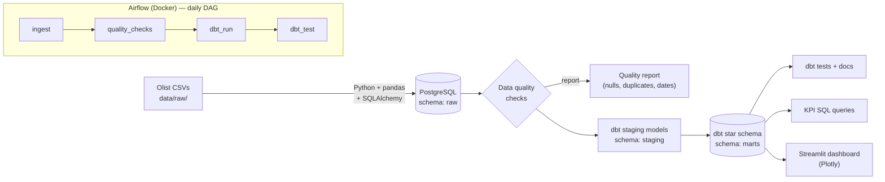
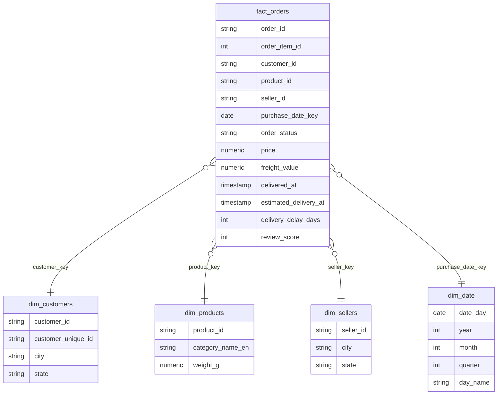

# Technical Design Document: Olist Sales Analytics Pipeline

| | |
|---|---|
| **Status** | In progress (Stage 1 of 8 complete) |
| **Last updated** | 2026-11-15 |
| **Author** | Yokesh |

---

## 1. Overview

### 1.1 Problem statement

Olist is a Brazilian e-commerce marketplace. Its public dataset (about 100k orders, 2016–2018) is split across 9 CSV files: orders, items, payments, reviews, customers, sellers, products, geolocation and a category-name translation table. In this form a business user can't easily answer questions like:

- How is revenue trending month over month?
- Which product categories and sellers drive the most sales?
- Where are deliveries late, and does lateness hurt review scores?
- How many customers come back to buy again?

### 1.2 Goal

Build a reproducible, end-to-end analytics pipeline that:

1. **Ingests** the raw CSVs into PostgreSQL.
2. **Validates** data quality and reports issues.
3. **Transforms** the data into a tested, documented star schema with dbt.
4. **Orchestrates** the whole flow daily with Airflow.
5. **Serves** KPIs through SQL queries and an interactive Streamlit dashboard.

### 1.3 Non-goals

- Real-time or streaming ingestion. The source is a static dataset, so batch is enough.
- Machine learning or forecasting.
- Production-grade security, high availability or multi-user access control.

### 1.4 Constraints

- Runs on a single Windows 11 laptop: Python 3.12, PostgreSQL, Docker Desktop.
- The repository stays **local only**: commits are made, but nothing is pushed to GitHub.
- No credentials in code. All secrets come from environment variables loaded from `.env`.
- The code must be simple and commented well enough to explain line by line in an interview.

---

## 2. Target architecture



### 2.1 Data layers

| Layer | Location | Owner | Purpose |
|---|---|---|---|
| Raw files | `data/raw/*.csv` | Kaggle download | Source of truth, never modified |
| `raw` schema | PostgreSQL | Ingestion script | 1:1 copy of each CSV, no cleaning |
| `staging` schema | PostgreSQL | dbt | Renamed columns, correct data types, light cleaning; one model per source table |
| `marts` schema | PostgreSQL | dbt | Star schema for analytics and the dashboard |

Keeping raw data untouched means a mistake in a transformation can always be fixed and rebuilt without downloading anything again.

### 2.2 Tech stack

| Concern | Tool | Why this choice |
|---|---|---|
| Language | Python 3.12 | Standard for data work; pandas ecosystem |
| Database | PostgreSQL | Free, widely used, supported by dbt and Airflow |
| Loading | pandas + SQLAlchemy | `DataFrame.to_sql` makes CSV → table a few lines of code |
| Transformation | dbt-postgres | SQL-based models with built-in testing, lineage and docs |
| Orchestration | Apache Airflow (Docker Compose) | Industry-standard scheduler; Docker avoids Windows install issues |
| Dashboard | Streamlit + Plotly | Pure-Python web app with interactive charts |
| Config | python-dotenv + `.env` | Keeps credentials out of source control |
| Version control | Git (local) | History of every stage |

---

## 3. What is built so far (Stage 1: project setup)

### 3.1 Repository layout

```
sales_analytics_pipeline/
├── .env.example          # template for DB credentials (committed)
├── .env                  # real credentials (git-ignored)
├── .gitignore
├── README.md
├── requirements.txt      # pinned Python dependencies
├── data/
│   └── raw/              # Olist CSVs go here (git-ignored, .gitkeep tracked)
├── docs/
│   └── technical_design.md
└── src/
    ├── db.py             # get_engine(): single place that builds the DB connection
    └── check_connection.py  # smoke test: connects and prints the Postgres version
```

### 3.2 Components

**`src/db.py`: connection helper**
- Calls `load_dotenv()` to read `.env` into environment variables. Values that are already set, for example by Docker later, are not overwritten.
- Builds the connection with `sqlalchemy.engine.URL.create(...)` rather than gluing a string together, so special characters in passwords are escaped safely.
- Required variables (`POSTGRES_USER`, `POSTGRES_PASSWORD`, `POSTGRES_DB`) are read with `os.environ[...]`, so a missing value fails immediately. Host and port have defaults (`localhost`, `5432`).

**`src/check_connection.py`: smoke test**
- Runs `SELECT version()`, prints the result, and catches `OperationalError` with a short hint about what to check.

**Dependency management**
- A project-local virtual environment in `.venv/`.
- `requirements.txt` pins exact versions: pandas 2.2.3, SQLAlchemy 2.0.36, psycopg2-binary 2.9.10, python-dotenv 1.0.1.

**Secrets handling**
- `.env` is git-ignored (checked with `git check-ignore`). Only `.env.example` with placeholder values is committed.

### 3.3 Current state

| Item | Status |
|---|---|
| Virtual environment created, dependencies installed | ✅ Done |
| Git repository initialized, Stage 1 committed (`910bb5c`) | ✅ Done |
| `olist` database created in PostgreSQL | ⏳ Pending (user) |
| Real password set in `.env` | ⏳ Pending (user) |
| Connection test passes | ⏳ Pending |
| Olist CSVs placed in `data/raw/` | ⏳ Pending (user) |

---

## 4. Planned design (Stages 2–8)

> These are design intentions. Details may change as each stage is built and tested.

### 4.1 Stage 2: Ingestion (`src/ingest.py`)

- Finds every `*.csv` in `data/raw/` and loads each one into the `raw` schema. The table name is the file name with the `olist_` prefix and `_dataset` suffix removed, for example `raw.orders`.
- **Re-runnable (idempotent):** each run fully replaces the table (`if_exists="replace"`), so running it twice gives the same result. For a static dataset of this size (about 120 MB), a full refresh is simpler and safer than incremental loading.
- Creates the `raw` schema if it doesn't exist.
- Adds a `_loaded_at` timestamp column for traceability.
- Writes in chunks to keep memory use low.
- **Logging:** Python's `logging` module writes to both the console and `logs/ingestion.log`: file name, row count and duration per table, plus any errors.

### 4.2 Stage 3: Data quality (`src/quality_checks.py`)

Checks run against the `raw` tables:

| Check | Example |
|---|---|
| Nulls in key columns | `orders.order_id`, `customers.customer_id` |
| Duplicate primary keys | duplicate `order_id` in `orders`; duplicate `(order_id, order_item_id)` in `order_items` |
| Unparseable dates | timestamp columns that can't be converted |
| Illogical dates | delivered before purchased; approved before purchased |

- Output: a short Markdown report (`reports/data_quality_report.md`) with each check, its row count and pass/warn status.
- Exit code: the script fails (non-zero) only on **critical** issues, such as duplicate primary keys, so Airflow can stop the pipeline. Known dataset quirks, such as missing delivery dates for cancelled orders, are reported as warnings.

### 4.3 Stage 4: Transformation (dbt-postgres)

**Staging models** (`models/staging/stg_*.sql`): one per raw table. They cast types, rename columns to clear snake_case, and translate product category names to English.

**Star schema** (`models/marts/`):



- **Grain of `fact_orders`:** one row per **order item** (`order_id` + `order_item_id`). This is the finest level that still links to a single product and seller, which category and seller revenue need. Order-level attributes (status, delivery dates, review score) repeat on each item row, so order-level metrics must count `DISTINCT order_id`.
- **`dim_date`:** generated as a continuous calendar covering the dataset's date range.
- **dbt tests:** `unique` and `not_null` on keys, `relationships` from fact to each dimension, and `accepted_values` on `order_status` and `review_score` (1–5).
- **Docs:** column descriptions in `schema.yml`, browsable with `dbt docs generate` and `dbt docs serve`, including the lineage graph.

### 4.4 Stage 5: Orchestration (Airflow in Docker)

- `docker-compose.yml` based on the official Airflow image, with its own small Postgres container for Airflow's metadata.
- Pipeline code and the dbt project are mounted into the containers.
- Airflow connects to the **laptop's** PostgreSQL through `host.docker.internal`. Credentials are passed as environment variables from `.env`, which is why `db.py` reads environment variables.
- DAG `olist_daily_pipeline`, scheduled `@daily`, `catchup=False`:

```
ingest  →  quality_checks  →  dbt_run  →  dbt_test
```

- Each task is a `BashOperator`. A failure stops everything downstream, and tasks retry once.

### 4.5 Stage 6: Analytics (`sql/`)

One commented `.sql` file per KPI, querying the `marts` schema:

| KPI | Definition |
|---|---|
| Monthly revenue | Sum of `price + freight_value` for delivered orders, by purchase month |
| Top categories | Revenue and order count by `category_name_en` |
| Delivery delays | Share of orders delivered after the estimated date; average days late |
| Repeat customers | Share of `customer_unique_id` values with more than one order |
| Review score by state | Average review score by customer state |

Note: in Olist, `customer_id` is unique per order. Repeat buyers can only be found through `customer_unique_id`.

### 4.6 Stage 7: Streamlit dashboard (`dashboard/`)

- Multi-page app: **Overview KPIs**, **Sales trends**, **Products & categories**, **Delivery & reviews**.
- Sidebar filters: date range, customer state, product category.
- Reads only from `marts` tables. Query results are cached with `@st.cache_data`.
- Charts built with Plotly.
- **Deployment (open decision):** Streamlit Community Cloud deploys only from a GitHub repo, which conflicts with the local-only constraint. The options are:
  1. Run the dashboard locally only (`streamlit run`). This is the default.
  2. Make an exception and push to GitHub for deployment, with the marts exported to a small file (Parquet/CSV) or a free hosted Postgres (Neon or Supabase).

### 4.7 Stage 8: README

Problem statement, architecture diagram (Mermaid), tech stack, setup and run instructions, key insights from the data, and dashboard screenshots.

---

## 5. Cross-cutting concerns

| Concern | Approach |
|---|---|
| **Security** | Credentials only in `.env` and environment variables; `.env` git-ignored; `.env.example` documents the required keys |
| **Reproducibility** | Pinned dependencies, virtual environment, Docker for Airflow, full-refresh loads |
| **Idempotency** | Every step can be re-run safely: ingestion replaces tables, dbt rebuilds models |
| **Observability** | Log files for ingestion, quality report per run, Airflow task logs and UI |
| **Testing** | Data quality checks on raw data; dbt tests on modeled data |
| **Simplicity** | Plain scripts and functions, no frameworks beyond the listed stack, comments on every non-obvious line |

## 6. Risks and open questions

| # | Item | Plan |
|---|---|---|
| 1 | Project sits in a OneDrive-synced folder; syncing `.venv/` may cause slowdowns or file locks | Monitor; move the project out of OneDrive if issues appear |
| 2 | Airflow in Docker must reach host Postgres | Use `host.docker.internal`; allow connections in `pg_hba.conf` if needed |
| 3 | Airflow and dbt dependency conflicts in one Python environment | Install dbt in a separate virtual environment inside the Airflow image |
| 4 | Dashboard deployment conflicts with the local-only rule | Decide before Stage 7 (see 4.6) |
| 5 | Known Olist quirks: missing delivery dates, products without a category, multiple reviews per order | Report in Stage 3; handle explicitly in dbt staging models |
