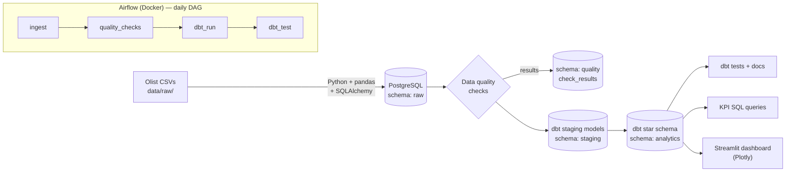
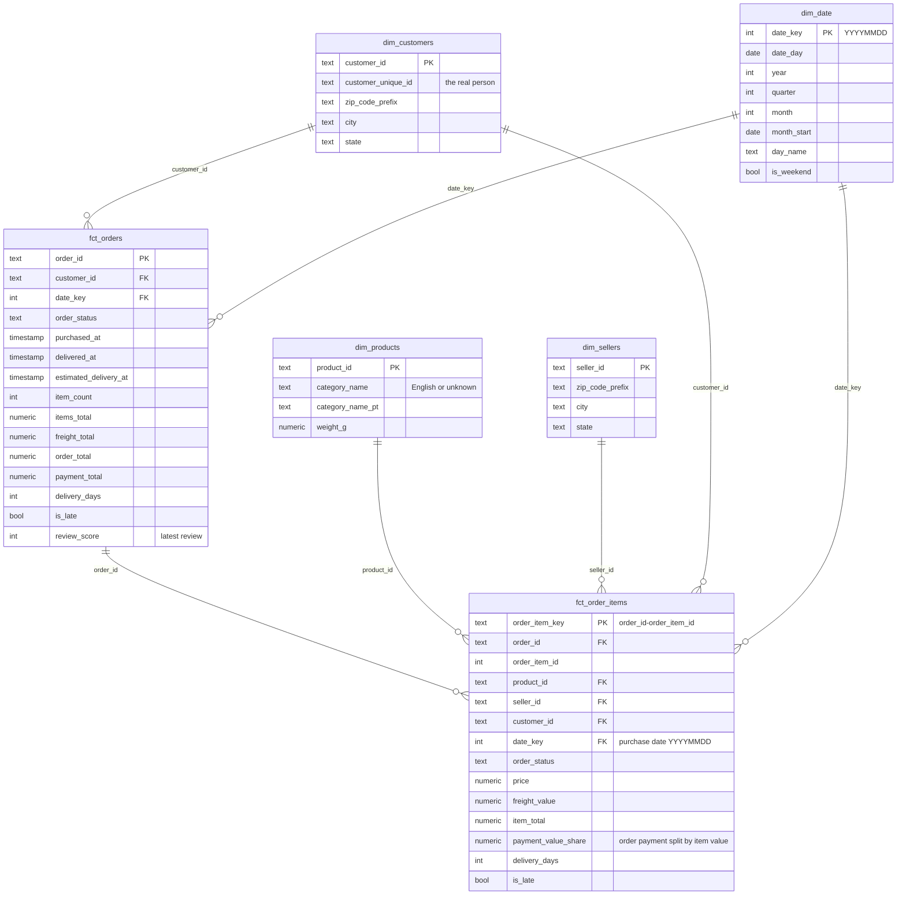

# Technical Design Document: Olist Sales Analytics Pipeline

| | |
|---|---|
| **Status** | In progress (Stages 1–4 of 8 complete) |
| **Last updated** | 2026-11-16 |
| **Author** | Yokesh |

---

## 1. Overview

### 1.1 Problem statement

Olist is a Brazilian e-commerce marketplace. Its public dataset (about 100k orders, 2016–2018) is split across 9 CSV files: orders, items, payments, reviews, customers, sellers, products, geolocation and a category-name translation table. In this form a business user can't easily answer questions like:

- How is revenue trending month over month?
- Which product categories and sellers drive the most sales?
- Where are deliveries late, and does lateness hurt review scores?
- How many customers come back to buy again?

### 1.2 Goal

Build a reproducible, end-to-end analytics pipeline that:

1. **Ingests** the raw CSVs into PostgreSQL.
2. **Validates** data quality and reports issues.
3. **Transforms** the data into a tested, documented star schema with dbt.
4. **Orchestrates** the whole flow daily with Airflow.
5. **Serves** KPIs through SQL queries and an interactive Streamlit dashboard.

### 1.3 Non-goals

- Real-time or streaming ingestion. The source is a static dataset, so batch is enough.
- Machine learning or forecasting.
- Production-grade security, high availability or multi-user access control.

### 1.4 Constraints

- Runs on a single Windows 11 laptop: Python 3.12, PostgreSQL, Docker Desktop.
- The repository stays **local only**: commits are made, but nothing is pushed to GitHub.
- No credentials in code. All secrets come from environment variables loaded from `.env`.
- The code must be simple and commented well enough to explain line by line in an interview.

---

## 2. Target architecture



### 2.1 Data layers

| Layer | Location | Owner | Purpose |
|---|---|---|---|
| Raw files | `data/raw/*.csv` | Kaggle download | Source of truth, never modified |
| `raw` schema | PostgreSQL | `src/ingest.py` | 1:1 copy of each CSV, all text, no cleaning |
| `quality` schema | PostgreSQL | `src/quality_checks.py` | History of data quality check results |
| `staging` schema | PostgreSQL | dbt | Renamed columns, correct data types, trimmed text, duplicates removed; one model per raw table |
| `analytics` schema | PostgreSQL | dbt | Star schema (facts + dimensions) for analytics and the dashboard |

Keeping raw data untouched means a mistake in a transformation can always be fixed and rebuilt without downloading anything again.

### 2.2 Tech stack

| Concern | Tool | Why this choice |
|---|---|---|
| Language | Python 3.12 | Standard for data work; pandas ecosystem |
| Database | PostgreSQL 18 | Free, widely used, supported by dbt and Airflow |
| Loading | pandas + SQLAlchemy | `DataFrame.to_sql` makes CSV → table a few lines of code |
| Transformation | dbt-core 1.12 + dbt-postgres 1.11 | SQL-based models with built-in testing, lineage and docs |
| Orchestration | Apache Airflow (Docker Compose) | Industry-standard scheduler; Docker avoids Windows install issues |
| Dashboard | Streamlit + Plotly | Pure-Python web app with interactive charts |
| Config | python-dotenv + `.env` | Keeps credentials out of source control |
| Version control | Git (local) | History of every stage |

---

## 3. What is built so far (Stages 1–4)

### 3.1 Repository layout

```
sales_analytics_pipeline/
├── .env.example          # template for DB credentials (committed)
├── .env                  # real credentials (git-ignored)
├── .gitignore
├── README.md
├── requirements.txt      # pinned Python dependencies
├── data/
│   └── raw/              # Olist CSVs go here (git-ignored, .gitkeep tracked)
├── dbt/                  # dbt project "olist_dbt"
│   ├── dbt_project.yml   # project settings: schemas + materializations
│   ├── profiles.yml      # connection, every value read with env_var()
│   ├── macros/
│   │   └── generate_schema_name.sql  # use schema names exactly as written
│   ├── models/
│   │   ├── staging/      # _sources.yml, _staging.yml, 9 x stg_*.sql
│   │   └── marts/        # _marts.yml, fct_*.sql, dim_*.sql
│   ├── target/           # compiled SQL + docs site (git-ignored)
│   └── logs/             # dbt logs (git-ignored)
├── docs/
│   └── technical_design.md
├── logs/                 # ingestion.log, quality.log (git-ignored)
└── src/
    ├── db.py             # get_engine(): single place that builds the DB connection
    ├── check_connection.py  # smoke test: connects and prints the Postgres version
    ├── ingest.py         # loads every CSV into the raw schema
    ├── quality_checks.py # data quality checks on the raw schema
    └── run_dbt.py        # loads .env, then runs any dbt command
```

### 3.2 Components

**`src/db.py`: connection helper**
- Calls `load_dotenv()` to read `.env` into environment variables. Values that are already set, for example by Docker later, are not overwritten.
- Builds the connection with `sqlalchemy.engine.URL.create(...)` rather than gluing a string together, so special characters in passwords are escaped safely.
- Required variables (`POSTGRES_USER`, `POSTGRES_PASSWORD`, `POSTGRES_DB`) are read with `os.environ[...]`, so a missing value fails immediately. Host and port have defaults (`localhost`, `5432`).

**`src/check_connection.py`: smoke test**
- Runs `SELECT version()`, prints the result, and catches `OperationalError` with a short hint about what to check.

**Dependency management**
- A project-local virtual environment in `.venv/`.
- `requirements.txt` pins exact versions: pandas 2.2.3, SQLAlchemy 2.0.36, psycopg2-binary 2.9.10, python-dotenv 1.0.1, dbt-core 1.12.7, dbt-postgres 1.11.0, dbt-adapters 1.24.5.

**Secrets handling**
- `.env` is git-ignored (checked with `git check-ignore`). Only `.env.example` with placeholder values is committed.
- dbt's `profiles.yml` reads every connection value with `env_var()`, so it contains no secrets and is safe to commit.

**`src/ingest.py`: ingestion (Stage 2)**
- Implements the design in section 4.1. Each CSV is read with `dtype=str`, so every raw column is `TEXT` and values such as zip codes keep their leading zeros.
- Each table is written inside its own transaction (`engine.begin()`). If a load fails partway, the previous version of that table is kept.
- Paths are built from the script's own location, so it works from any working directory.
- A full run takes about 80 seconds. Most of that is `geolocation`, at 1M rows and about 44 seconds.

**Loaded tables (verified 2026-11-16).** Row counts in PostgreSQL match an independent count of each CSV, done with Python's `csv` module:

| Table | Rows |
|---|---:|
| `raw.customers` | 99,441 |
| `raw.geolocation` | 1,000,163 |
| `raw.order_items` | 112,650 |
| `raw.order_payments` | 103,886 |
| `raw.order_reviews` | 99,224 |
| `raw.orders` | 99,441 |
| `raw.products` | 32,951 |
| `raw.sellers` | 3,095 |
| `raw.product_category_name_translation` | 71 |

**`src/quality_checks.py`: data quality (Stage 3)**
- 50 checks. Each one is a SQL query that counts the rows breaking one rule. 0 rows means PASS; otherwise the check gets its severity, **FAIL** (broken keys) or **WARN** (smaller issues).
- Check types: row count > 0, primary key not-null and unique, foreign keys resolve (orphan count), nulls in important columns, text that converts cleanly to timestamp or numeric (`pg_input_is_valid`, PostgreSQL 16+), value ranges (prices ≥ 0, review score 1–5, known order statuses), and date logic.
- If a check's query errors (for example a missing table), that check is marked FAIL rather than crashing the whole run.
- Results are appended to `quality.check_results` with a `run_at` timestamp, so the history of every run is kept. They're also logged to `logs/quality.log` and printed as a summary table.
- Exit code 1 if any check FAILs, so Airflow will stop the pipeline. Tested with an injected failing check.

**Quality results (run 2026-11-16): 46 PASS, 4 WARN, 0 FAIL**

| Check | Table | Status | Rows | What it means | Handling (done in Stage 4) |
|---|---|---|---:|---|---|
| `unique(review_id)` | order_reviews | WARN | 814 extra rows (789 review IDs) | Each duplicated `review_id` is attached to *different* orders: one review covering several orders. 547 orders also have more than one review. | ✅ `stg_order_reviews` uses key `review_id + order_id`. `fct_orders` keeps only the latest review per order, leaving 0 duplicate orders. |
| `not_null(product_category_name)` | products | WARN | 610 (1.85%) | These products also have no name or description lengths: missing catalog data. They appear in 1,603 order items. | ✅ Labeled `unknown` in `stg_products`, so their revenue stays in totals. |
| `fk(product_category_name -> translation)` | products | WARN | 13 | Two categories have no English translation: `pc_gamer` (3) and `portateis_cozinha_e_preparadores_de_alimentos` (10). | ✅ Translated by hand in `stg_products` (`pc_gamer`, `portable_kitchen_and_food_preparers`). |
| `delivered orders have delivery date` | orders | WARN | 8 | Status is `delivered` but the customer delivery date is missing; 7 of the 8 do have a carrier date. | ✅ Documented only. `delivery_days` and `is_late` are NULL for these, so they drop out of delivery KPIs automatically but stay in revenue. |

**`src/run_dbt.py` + `dbt/`: transformation (Stage 4)**
- `run_dbt.py` loads `.env`, then runs dbt in the same Python process (`dbtRunner`) with `--project-dir dbt --profiles-dir dbt`. dbt itself doesn't read `.env` files. In Airflow, Docker will supply the same environment variables directly.
- `generate_schema_name` macro: by default dbt would build into `analytics_staging`. The override makes it use `staging` and `analytics` exactly.
- **Staging and marts are both materialized as tables.** This resolves risk #5 (section 6): PostgreSQL won't drop a table that a *view* depends on, so staging views would make `ingest.py` fail on re-run. I chose tables over making ingestion `DROP ... CASCADE`, because CASCADE would silently delete the dbt models and leave the dashboard empty until the next `dbt run`. The cost of tables is extra disk space (small here) and the data being as fresh as the last `dbt run`, which is fine for a daily batch. Verified: `ingest.py` re-ran successfully with all dbt tables in place.

#### Staging vs marts (interview version)

- **Staging = clean copies.** One model per raw table. It only *tidies*: clear column names, correct types (text → timestamp/numeric), trimmed text, exact duplicates removed. No business logic and no combining of tables (except the category translation lookup). If a raw column is renamed upstream, only one staging model changes.
- **Marts = business-ready tables.** Built *from staging*, shaped for questions people ask: revenue by month, by category, late deliveries. This is what the dashboard and the KPI queries read.

#### Fact vs dimension, and grain (interview version)

- **Fact table = events you measure.** Each row is something that happened (an order, an item sold) with numbers you can add up: price, freight, payment. Facts are long and narrow.
- **Dimension table = the context you filter and group by.** *Who* (customer, seller), *what* (product), *when* (date). Dimensions are short and wide (descriptive columns).
- **Star schema** = one fact in the middle, dimensions around it, joined by keys. It's simple to query: one join per question ("revenue by state" = fact join dim_customers, group by state).
- **Grain = what one row means.** It's the first thing to decide, because it determines what you can sum safely.
  - `fct_order_items`: **one row per item in an order.** This is the only level that links to one product and one seller, so it's used for category and seller revenue.
  - `fct_orders`: **one row per order.** Used for order counts, average order value, delivery and reviews. Without it, an order with 3 items would be counted 3 times.

#### Star schema (built)



Design notes:
- **Two fact tables at two grains**, rather than one. `fct_order_items` gets order-level values (customer, date, delivery) by joining `fct_orders`, so delivery logic is written once.
- **`fct_orders` includes all 99,441 orders**, including 775 with no items (mostly canceled or unavailable). Their money columns are 0, so status counts stay complete.
- **`payment_value_share`:** payments are recorded per order, not per item, so each item gets a share in proportion to its value (`payment_total × item_total / order_total`). Shares match order payments for every order except one 21-item order, which is 6 cents off from rounding.
- **`dim_date`** is generated with `generate_series` over the full date range (800 days). It includes days with no sales, so charts have no gaps. `date_key` is an integer `YYYYMMDD`.
- **Composite keys** (order item, payment, review) are combined into one text key, such as `order_id-order_item_id`, so they can use dbt's built-in `unique` test without an extra package.

**dbt run results (2026-11-16)**
- `dbt run`: 15 models (9 staging + 6 marts), all OK, about 17 seconds.
- `dbt test`: **65 tests, all PASS**. These are `unique`/`not_null` on every primary key, `relationships` from both facts to every dimension (and items → orders), and `accepted_values` for `order_status`, `payment_type` and `review_score`.
- `dbt docs generate`: docs site written to `dbt/target/`. View it with `python src/run_dbt.py docs serve`.

| Mart | Rows |
|---|---:|
| `analytics.fct_order_items` | 112,650 |
| `analytics.fct_orders` | 99,441 |
| `analytics.dim_customers` | 99,441 |
| `analytics.dim_products` | 32,951 |
| `analytics.dim_sellers` | 3,095 |
| `analytics.dim_date` | 800 |

**Reconciliation checks (raw vs marts)**

| Check | Result |
|---|---|
| Item price total: raw = `fct_order_items` = `fct_orders` | ✅ 13,591,643.70 in all three |
| Payment total: raw = `fct_orders` | ✅ 16,008,872.12 in both |
| Sum of `payment_value_share` vs payment total | 15,846,281.23. The 162,591.95 difference is exactly the payments of the 775 orders with no items (no item rows to share them across). |
| Geolocation duplicates removed | 1,000,163 → 738,332 (−261,831, matches Stage 3) |
| Delivered orders / average delivery / late rate | 96,476 orders, 12.5 days on average, 6.8% late |

### 3.3 Current state

| Item | Status |
|---|---|
| Virtual environment created, dependencies installed | ✅ Done |
| Git repository initialized, Stage 1 committed (`910bb5c`) | ✅ Done |
| `olist` database created, `.env` configured | ✅ Done |
| Connection test passes (PostgreSQL 18.7) | ✅ Done |
| Olist CSVs placed in `data/raw/` (9 files) | ✅ Done |
| Ingestion loads all 9 tables; counts match CSVs | ✅ Done |
| Re-run gives identical counts (idempotent) | ✅ Verified |
| A failing file is logged and skipped; run exits with code 1 | ✅ Verified (test with an empty CSV) |
| Quality checks run: 50 checks, 46 PASS / 4 WARN / 0 FAIL | ✅ Done |
| Results saved to `quality.check_results` and `logs/quality.log` | ✅ Verified |
| Any FAIL makes the script exit with code 1 | ✅ Verified (injected test check, removed afterwards) |
| dbt installed, `dbt debug` passes with credentials from `env_var()` | ✅ Done |
| 9 staging models + star schema (2 facts, 4 dimensions) built | ✅ Done |
| 65 dbt tests pass | ✅ Done |
| All 4 Stage 3 warnings handled | ✅ Done (see table above) |
| Marts reconcile with raw totals | ✅ Verified |
| `ingest.py` re-runs with dbt tables present (risk #5) | ✅ Verified |
| dbt docs generated | ✅ Done |
| Stage 5: Airflow orchestration in Docker | ⏳ Next |

---

## 4. Planned design (Stages 5–8)

> Sections 4.1–4.3 describe the original plan for stages already built. Section 3 has what was actually built. Sections 4.4 onward are still plans and may change.

### 4.1 Stage 2: Ingestion (`src/ingest.py`) (built)

- Finds every `*.csv` in `data/raw/` and loads each one into the `raw` schema. The table name is the file name with the `olist_` prefix and `_dataset` suffix removed, for example `raw.orders`.
- **Re-runnable (idempotent):** each run fully replaces the table (`if_exists="replace"`), so running it twice gives the same result. For a static dataset of this size (about 120 MB), a full refresh is simpler and safer than incremental loading.
- Creates the `raw` schema if it doesn't exist.
- Adds a `_loaded_at` timestamp column for traceability.
- Writes in chunks to keep memory use low.
- **Logging:** Python's `logging` module writes to both the console and `logs/ingestion.log`: file name, row count and duration per table, plus any errors.

### 4.2 Stage 3: Data quality (`src/quality_checks.py`) (built)

- Checks for nulls in key columns, duplicate primary keys, broken foreign keys, unparseable values, out-of-range values and illogical dates.
- Output: results are stored in the table `quality.check_results` (one row per check per run), logged to `logs/quality.log`, and printed as a summary. This replaces the Markdown report file originally planned, because a table keeps history and can be queried or charted later.
- Exit code: non-zero only on **critical** issues (broken keys), so Airflow can stop the pipeline. Known dataset quirks are reported as warnings.

### 4.3 Stage 4: Transformation (dbt) (built)

The built design differs from the original plan in two ways:
- **Two facts instead of one:** the plan had a single item-level `fact_orders`. The build adds an order-level `fct_orders`, so order counts, delivery metrics and review scores don't need `COUNT(DISTINCT order_id)` workarounds.
- **The schema is named `analytics`**, not `marts`.

### 4.4 Stage 5: Orchestration (Airflow in Docker)

- `docker-compose.yml` based on the official Airflow image, with its own small Postgres container for Airflow's metadata.
- Pipeline code and the dbt project are mounted into the containers.
- Airflow connects to the **laptop's** PostgreSQL through `host.docker.internal`. Credentials are passed as environment variables from `.env`, which is why `db.py` and `profiles.yml` read environment variables.
- DAG `olist_daily_pipeline`, scheduled `@daily`, `catchup=False`:

```
ingest  →  quality_checks  →  dbt_run  →  dbt_test
```

- Each task is a `BashOperator`. A failure stops everything downstream, and tasks retry once.

### 4.5 Stage 6: Analytics (`sql/`)

One commented `.sql` file per KPI, querying the `analytics` schema:

| KPI | Definition | Source |
|---|---|---|
| Monthly revenue | Sum of `price + freight_value` for delivered orders, by purchase month | `fct_order_items` + `dim_date` |
| Top categories | Revenue and order count by `category_name` | `fct_order_items` + `dim_products` |
| Delivery delays | Share of delivered orders with `is_late`; average `delivery_days` | `fct_orders` |
| Repeat customers | Share of `customer_unique_id` values with more than one order | `fct_orders` + `dim_customers` |
| Review score by state | Average `review_score` by customer state | `fct_orders` + `dim_customers` |

Note: in Olist, `customer_id` is unique per order. Repeat buyers can only be found through `customer_unique_id`.

### 4.6 Stage 7: Streamlit dashboard (`dashboard/`)

- Multi-page app: **Overview KPIs**, **Sales trends**, **Products & categories**, **Delivery & reviews**.
- Sidebar filters: date range, customer state, product category.
- Reads only from `analytics` tables. Query results are cached with `@st.cache_data`.
- Charts built with Plotly.
- **Deployment (open decision):** Streamlit Community Cloud deploys only from a GitHub repo, which conflicts with the local-only constraint. The options are:
  1. Run the dashboard locally only (`streamlit run`). This is the default.
  2. Make an exception and push to GitHub for deployment, with the marts exported to a small file (Parquet/CSV) or a free hosted Postgres (Neon or Supabase).

### 4.7 Stage 8: README

Problem statement, architecture diagram (Mermaid), tech stack, setup and run instructions, key insights from the data, and dashboard screenshots.

---

## 5. Cross-cutting concerns

| Concern | Approach |
|---|---|
| **Security** | Credentials only in `.env` and environment variables; `.env` git-ignored; `.env.example` documents the required keys; dbt reads them with `env_var()` |
| **Reproducibility** | Pinned dependencies, virtual environment, Docker for Airflow, full-refresh loads |
| **Idempotency** | Every step can be re-run safely: ingestion replaces raw tables, dbt rebuilds all models as tables |
| **Observability** | Log files for ingestion and quality, `quality.check_results` history, dbt logs, Airflow task logs and UI |
| **Testing** | Data quality checks on raw data (50 checks); dbt tests on modeled data (65 tests); reconciliation of totals between layers |
| **Simplicity** | Plain scripts and functions, no frameworks beyond the listed stack, no extra dbt packages, comments on every non-obvious line |

## 6. Risks and open questions

| # | Item | Plan |
|---|---|---|
| 1 | Project sits in a OneDrive-synced folder; syncing `.venv/` may cause slowdowns or file locks | Monitor; move the project out of OneDrive if issues appear |
| 2 | Airflow in Docker must reach host Postgres | Use `host.docker.internal`; allow connections in `pg_hba.conf` if needed |
| 3 | Airflow and dbt dependency conflicts in one Python environment | Install dbt in a separate virtual environment inside the Airflow image |
| 4 | Dashboard deployment conflicts with the local-only rule | Decide before Stage 7 (see 4.6) |
| 5 | ~~`if_exists="replace"` drops raw tables; dbt staging views would block it~~ | ✅ **Resolved in Stage 4:** staging is materialized as tables (see 3.2). Verified by re-running ingestion. |
| 6 | ~~Known Olist quirks: missing delivery dates, products without a category, multiple reviews per order~~ | ✅ **Resolved in Stage 4:** handled in staging and `fct_orders` (see Stage 3 table in 3.2) |
| 7 | Marts are only as fresh as the last `dbt run`; re-running ingestion alone doesn't update them | Expected for daily batch; the Airflow DAG always runs dbt after ingestion |
